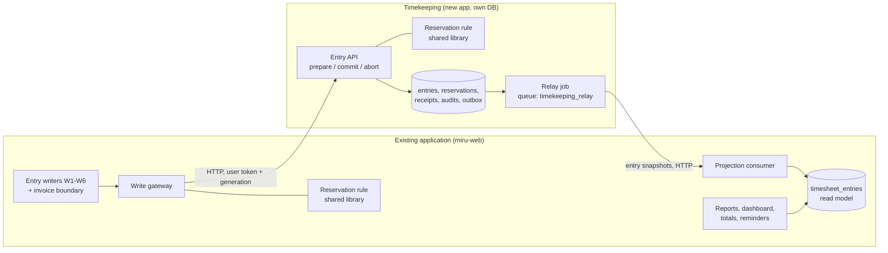

# Cobb Your Dependencies

**Technical design: extracting Timekeeping behind one write gateway, one reservation rule and one read model**

| | |
|---|---|
| Status | Proposed, revision 2. For review. **Not authorization to implement.** |
| Tracking issues | #3 (original assignment), #5 (this revision) |
| Code baseline | `main` at `e8cf97b` (Miru at `c2f4a01756e`) |
| Date | 2026-11-10 |
| Scope of this change | This document only. No application code, tests, schema, migrations, dependencies, CI, infrastructure or runtime configuration is changed by it. |

---

## Summary

Miru is one Rails 8.1 application on one Postgres database. Billing writes timekeeping rows directly:
saving a draft invoice sets `timesheet_entries.locked` from an `after_save` callback, and line-item and
invoice callbacks clear it again (`app/models/invoice.rb:62-63`, `app/models/invoice_line_item.rb:10,72-76`).
Reports read `timesheet_entries` with SQL joins against invoices.

This design does **one** extraction and proves it end to end:

1. **One new service, Timekeeping**, deployed on its own with its own database, in this repository. It
   owns time entries and their billing reservations. Identity, catalogue (clients, projects, members,
   rates), billing and reporting stay in the existing application.
2. **Three components replace today's lock callbacks.** Each can be understood on its own:
   - the **write gateway**, the one module in the existing application through which every entry
     write and every reservation passes (§3.1);
   - the **reservation rule**, one decision table in a shared library: an entry has at most one
     reservation by a kept invoice, provisional or committed, changed only through prepare, commit
     and abort (§7);
   - the **read model**, `timesheet_entries` itself, which becomes a read-only projection of
     Timekeeping written by one consumer (§3.2).
3. **One cutover** for the whole dataset (both seeded businesses), in one bounded write pause under one
   global ownership generation. Rollback and re-cutover use the same procedure in the other direction
   (§10).
4. **Values do not change.** `duration` stays a float. Migration, rollback and re-cutover never
   recompute or convert an invoice amount, rate or quantity (§8).
5. **Two deliberate behaviour fixes**, approved by the repository owner: double allocation is refused,
   and discarding a draft releases its entries (§2.3). Everything else the code does today is
   preserved, including the anomalies listed in §2.

What this revision removes from revision 1: the Billing service, Core directory feeds and replicas, the
reporting projections (`rpt_*`), the hold/confirm/cancel claim protocol with TTLs and revisions, the
`compat`/`corrected` lock-rule sets, per-company routing and waves, seven phases and their soak
periods, and row-level security. Deferred rollout notes are kept in §15.3.

---

## How to read this document

| Tag | Meaning |
|---|---|
| **[O]** | Observed in the code at the cited `path:line`, or confirmed by the characterization run in Appendix A (`K#`). |
| **[P]** | Proposed by this design. |

Behaviour IDs: `A#` entry rules and authorization, `L#` locking and billing links, `M#` money.
`K#` is a characterization case. `D#` is a decision (§15.1).

**Precedence.** The code sets current behaviour. The repository owner's decisions set target
behaviour. Where revision 1 described today's behaviour differently from the code, this revision
follows the code.

---

## 1. The existing system [O]

### 1.1 Runtime

| Concern | Today | Source |
|---|---|---|
| Web | Falcon | `Procfile`, `falcon.rb` |
| Jobs | Solid Queue. Workers for queues `default` and `billing_sync`; recurring tasks run from the dispatcher | `config/solid_queue.yml`, `config/application.rb:85` |
| Job retries | `retry_on ActiveRecord::Deadlocked, attempts: 3` and `retry_on ConnectionFailed / PG::ConnectionBad, attempts: 5`. `attempts` counts **total** attempts, so these are 2 and 4 retries. | `app/jobs/application_job.rb:5,8-9` |
| Database | One Postgres database; Solid Queue tables live in it | `config/database.yml`, `db/schema.rb` |
| Deploy | Kamal (`config/deploy.yml`: service `miru-web`, roles `web` and `worker`) and Render (`render.yaml`) | |
| Config | In `config/deploy.yml`, `REDIS_URL` is a plain `env` value (`:59`); `DATABASE_URL` is in the `secret` list (`:60-63`) | `config/deploy.yml:59-63` |
| Events | `Rails.event.notify` from model callbacks, recorded by `rails_event_viewer` for observability. No outbox. | `config/initializers/rails_event_viewer.rb`, `docs/ai/events.md` |

### 1.2 Data model and tenancy

- `timesheet_entries` has no `company_id`. Tenancy is derived project → client → company
  (`scope :in_workspace`, `app/models/timesheet_entry.rb:63`; `has_one :company, through: :client`, `:44-45`).
- Tenancy is enforced **by convention**, through `current_company` in controllers and policy scopes. There
  is no default scope (`app/controllers/concerns/current_company_concern.rb`).
- `timesheet_entries.duration` is `float` (minutes). `invoice_line_items.quantity` is `integer`
  (minutes) (`db/schema.rb:560`). `invoice_line_items.rate` is `decimal(20,2)`.
- Two foreign keys point from billing at entries: `invoice_line_item_time_entries → timesheet_entries`
  (`db/schema.rb:1282`) and `invoice_line_items → timesheet_entries` (`:1284`).
- Nothing in the database stops one entry from being on several invoices. The join table is unique only
  per (line item, entry) pair (`db/schema.rb:549`) (K6).

### 1.3 Every writer of `timesheet_entries`

| # | Writer | Entry point | Authorization today |
|---|---|---|---|
| W1 | Web and mobile entry CRUD, `Api::V1::TimesheetEntryController` | `/api/v1/timesheet_entry`, `/api/v1/mobile/timesheet_entries` (`config/routes/api.rb:76`) | `TimesheetEntryPolicy`; project from `current_company.projects.kept`, no membership check (`timesheet_entry_controller.rb:60-62`) |
| W2 | Bulk move and bulk delete, `TimesheetEntry::BulkActionController` | `PATCH/DELETE /api/v1/timesheet_entry/bulk_action` | `bulk_update?`/`bulk_destroy?` plus its own `entry_locked?` (`bulk_action_controller.rb:65-70`) |
| W3 | CLI, `Api::V1::Cli::TimesheetEntriesController` | `/api/v1/cli/timesheet_entries` | Pundit; record looked up in `current_user.timesheet_entries` (`cli/timesheet_entries_controller.rb:51`) |
| W3a | **MCP** tools `miru.time.{create,update,delete}` | `/mcp` | Calls W3 **in-process** through `Rack::MockRequest` (`app/mcp/api_proxy.rb:40`), not over HTTP, with the caller's `Authorization` |
| W4 | Agent API, `Api::V1::Agent::TimesheetEntriesController#create` | `POST /api/v1/agent/timesheet_entries` | Agent key. **Skips Pundit** (`agent/base_controller.rb:7`); only applies `ProjectPolicy::Scope` for the agent's user (`agent/timesheet_entries_controller.rb:4-18,28-31`) |
| W5 | Harvest import | `DataImportJob`; rake `imports:harvest_time_entries` | `DataImportPolicy` at upload; rows written with no `Current.user`. Creates `billed` rows as `unbilled`, then `update!(bill_status: :billed)` (`harvest_time_entries_importer.rb:469,475`) |
| W6 | **Agent destroy** | `Agent has_many :timesheet_entries, dependent: :nullify` (`app/models/agent.rb:11`), reached through `Company has_many :agents, dependent: :destroy` (`company.rb:49`) and `User has_many :agents, dependent: :destroy` (`user.rb:39`) | None of its own. Rewrites `agent_id` to `NULL` on the agent's entries (K8). Revision 1 did not list this writer. |
| W7 | Invoice callbacks | §1.4 | `InvoicePolicy`, `Invoices::BulkDeletionPolicy` |
| W8 | Demo seeder | `analytics:seed_demo` (`app/services/analytics/demo_seeder.rb`) | n/a |

Model rules every writer shares (`app/models/timesheet_entry.rb`):

- `source` is normalized on every save. The agent controller sets `"automation"`, and the model rewrites it
  to `"mcp"` when `source_metadata["mcp_server"]` is present (`:190,232-235`) (K10).
- Agent entries are forced to `review_status: pending_review` (`:142-151`).
- `locked` blocks updates only for the `employee` role, and only when `Current.user` is set (`:180-186`).
  Jobs, imports and rake tasks bypass it.

### 1.4 How billing writes entries today

- **Draft save locks.** `after_save :lock_timesheet_entries, if: :draft?` sets `locked = true` on every
  entry the invoice references, direct and linked (`invoice.rb:62,200-202`) (K1).
- **Draft discard re-locks.** `after_discard :unlock_timesheet_entries, if: :draft?` runs first. Then
  `after_discard :update_invoice_number` calls `update` (`:64,323-325`). That save fires
  `after_save :lock_timesheet_entries` again, because the invoice is still a draft. The entries **stay
  locked** (K2).
- **Non-draft discard** does nothing to entries: they stay locked (K3).
- **Line-item destroy** releases its entries only when the invoice is a draft (`invoice_line_item.rb:10,72-76`) (K4).
- **Send** (`record_send!`) changes the invoice only. Entries stay `unbilled` (K5). The only code that sets
  `billed` from billing, `Invoice#update_timesheet_entry_status!` (`invoice.rb:126-128`), is reached only
  from `InvoiceMailer#invoice`, which has no live caller.
- **Single delete is soft, bulk delete is hard.** `InvoicesController#destroy` calls `discard!`
  (`app/controllers/api/v1/invoices_controller.rb:59-62`). `Invoices::BulkDeletionController` calls
  `destroy` on `current_company.invoices.where(id: …)`, with **no `.kept` filter**, so it also hard-deletes
  already-discarded invoices (`invoices/bulk_deletion_controller.rb:7-8`). A hard-deleted draft releases
  its entries through the line-item callback. A hard-deleted non-draft leaves them locked, with no row left
  that references them (K7).
- **Mobile collections create invoices outside `InvoicePolicy`.** `Mobile::CollectionsController` skips
  `verify_authorized` and allows any owner, admin, book keeper **or employee** of a company with pro
  access (`mobile/collections_controller.rb:6-7,155-161`). It creates invoices with `status: :sent` and
  records payments (`:238-258`). These invoices have no time-entry lines.
- **Foreign keys.** The two keys in §1.2 tie line items to entry rows. Today they are harmless. Once
  entries are owned elsewhere they would reject a line item whose entry is not yet in the local table, so
  this design **drops them before cutover** (§10.2).

### 1.5 Line items and quantity

`GenerateInvoice::NewLineItemsService` only **suggests** line items. It offers the entry's float
`duration` as `quantity` (`new_line_items_service.rb:110`; summed per group at `:140`). The client posts
`quantity` back in `invoice_line_items_attributes`, and it is stored in an **integer** column
(`db/schema.rb:560`). Fractional minutes are cast away on save: 90.7 becomes 90 (K9). Candidate selection
hides entries already on a kept invoice, but explicit ids posted through the API or MCP are not checked
(K6).

### 1.6 Money, PDF and audit

- Stored invoice totals: subtotal = Σ(`quantity`/60 × `rate`) in Float, rounded to 2 dp; tax recomputed
  while draft; `amount` = subtotal − discount + tax (`invoice.rb:226-257,304`).
- The PDF **recomputes** the subtotal as `(SUM(quantity * rate) / 60.0).round(3)` and the total as
  `subtotal + tax - discount`, **unrounded** (`invoice_line_item.rb:20-22`;
  `pdf_generation/invoice_service.rb:24-25,46-54`). The printed total can therefore differ from the stored
  `amount`. Example: 19 minutes at 33.33 is stored as 10.55 and printed as $10.56 (K11).
- Line `total_cost` rounds `(quantity/60) × rate` to 3 dp (`invoice_line_item.rb:46-47`).
- **The audit log cannot prove financial parity.** `audited` on `Invoice` covers only `amount`,
  `base_currency_amount`, `exchange_rate`, `exchange_rate_date`, `currency`, `status`, `amount_paid` and
  `amount_due` (`invoice.rb:10-11`). It omits `discount`, `tax` and `outstanding_amount`. Line items and
  invoice taxes are not audited. Parity is proven by a snapshot comparison instead (§10.4, §13).

### 1.7 Readers of `timesheet_entries`

Every reader below keeps reading the table unchanged (§3.3):

- Time tracking: `TimeTrackingIndexService`, `Reports::TimeEntries::{ReportService,FilterService}`, `TimeEntries::Filters`.
- Reports and analytics: `Analytics::TeamProductivityAnalytics` (joins invoice line items), `Analytics::GrowthMetricsService`,
  `Reports::ClientRevenues::ReportDecorator` (sums entry `duration` per client, `report_decorator.rb:159-164`),
  `Metrics::DataBuilder`, `AnalyticsController`.
- Project, client and team totals: `Project` (`project.rb:48-82`), `ProjectSqlQueries`, `Projects::IndexService`,
  `Client`, `Clients::IndexService`, `Team::IndexDecorator`, `Team::RemovalImpactService`.
- Dashboard: `DashboardPresenter`. Reminders: `WeeklyReminderForMissedEntriesService`.
- Billing: `GenerateInvoice::NewLineItemsService` (candidate selection) and line-item validation (L8).

`Metrics::DataBuilder` line 86 filters `:non_billable`, which exists. Lines 85 and 140 filter
`bill_status: :billable`, which is **not** a value of the enum (`timesheet_entry.rb:14`), so billable hours
there are always zero. The design preserves this (D4).

### 1.8 Identity

Authentication order: session → CLI bearer → devise-jwt → legacy `X-Auth-Email`/`X-Auth-Token`
(`app/controllers/concerns/authenticable.rb`). Agents authenticate with an `AgentKey` and are signed in as
`agent.user` with the workspace forced to `agent.company` (`agent/base_controller.rb:14-44`). Roles come from
rolify, checked live per request.

---

## 2. Behaviour

### 2.1 Entry rules and authorization (preserved) [O]

| ID | Rule | Evidence |
|---|---|---|
| A1 | Owner, admin and employee may create and list entries. | `timesheet_entry_policy.rb:4-14` |
| A2 | Web/mobile: the project is any kept project of the company; no membership check. Owner/admin may log for any company user, others only for themselves. | `timesheet_entry_controller.rb:54-76` |
| A3 | Update and destroy are refused when the entry is `billed`. | `timesheet_entry_policy.rb:24-25` |
| A4 | For non-owner/admin users, update and destroy are refused when `work_date` is older than `company.timesheet_edit_days`. | `:26,43-53` |
| A5 | Otherwise owner/admin of the entry's company, or the entry's own user, may update and destroy. | `:27-29,38-41` |
| A6 | Scope: owner/admin see all kept entries of the workspace, others their own. | `:62-68` |
| A7 | CLI and MCP: a caller can only update or delete their own entries, whatever their role. | `cli/timesheet_entries_controller.rb:51` |
| A8 | `review_status` does not affect invoicing; `pending_review` agent entries are invoiceable. | `new_line_items_service.rb` |
| A9 | Bulk move and delete treat `billed` or out-of-window entries as locked (403). Bulk move uses non-bang `update` on the relation, so an entry the model rejects, such as a `locked` entry moved by an employee, is **silently skipped** and the response is still 200. | `bulk_action_controller.rb:27,65-70` (K12) |
| A10 | Agent entries: user forced to the agent's user, `review_status: pending_review`, no dedupe on `external_run_id`, `source` rewritten to `mcp` when `source_metadata["mcp_server"]` is present. | `timesheet_entry.rb:142-151,232-235` (K10) |
| A11 | `bill_status` is settable by any user who may edit the entry (W1 and W3 permit it), so an employee can mark their own entry `billed`. An employee cannot change it **away** from `billed`. The import sets it too. | `timesheet_entry_controller.rb:79`, `timesheet_entry.rb:157-162` (K13) |

**The agent API does not get A1-A7.** It skips Pundit and applies only the project scope (W4). This design
keeps exactly that.

### 2.2 Authorization timing [O]

`authorize` runs before the write's transaction opens. It reads the caller's role and
`company.timesheet_edit_days` (A3-A5). Inside the transaction only model validations run. Two of them read
the caller's primary role again: the `locked` check and the `billed` check (`timesheet_entry.rb:157-162,180-186`).
This is why the gateway can resolve these facts per request and pass them as claims (§6.1) without changing
how fresh they are.

### 2.3 Locking and billing links

Preserved [O]:

| ID | Behaviour | Evidence |
|---|---|---|
| L1 | Saving a draft locks every entry it references. Entries added while the invoice is not a draft are not locked. The lock stops employees only. | `invoice.rb:62`, `timesheet_entry.rb:180-186` (K1) |
| L3 | Discarding a non-draft invoice keeps its entries locked. Those entries become selectable again. | `invoice.rb:63` (K3) |
| L4 | Removing a line item releases its entries only on a draft. On a non-draft they stay locked. | `invoice_line_item.rb:72-76` (K4) |
| L5 | Only three things set `billed`: the import (W5), any user who may edit the entry (A11), and the unreachable `update_timesheet_entry_status!`. | §1.3, §1.4 |
| L6 | Sending an invoice leaves its entries `unbilled`. | K5 |
| L7 | `bill_status` is independent of invoices. No live invoice operation sets or clears it. `billed` blocks edits for every role (A3) and removes the entry from selection. | `new_line_items_service.rb` |
| L8 | A line item may reference only entries of the invoice's company. | `invoice_line_item.rb:56-70`, `invoice_line_item_time_entry.rb:12-17` |

Changed by the repository owner's decision (L2 is today's draft-discard behaviour):

**Deliberate fixes**

| # | Case | Today | After | What a user sees |
|---|---|---|---|---|
| F1 | An entry already on a kept invoice is put on a second one | Allowed. Both invoices lock one boolean. Candidate selection hides such entries, but explicit ids through the API or MCP get through (K6). | Prepare is refused: the entry is on another invoice. | An explicit double allocation fails with a clear error instead of billing the time twice. Normal selection is unchanged. |
| F2 (L2) | A draft invoice is discarded | Its entries stay locked. `after_discard :unlock_timesheet_entries` runs, then `update_invoice_number` calls `update`, which fires `after_save :lock_timesheet_entries` again (`app/models/invoice.rb:62-64`, `:323-325`) (K2). | Its reservations are released. | An employee can edit time that was on a discarded draft. |

Historical invoices and amounts do not change under either fix. Both fixes stay in force through
rollback (§10.5).

### 2.4 Money (preserved) [O]

| ID | Behaviour |
|---|---|
| M1 | The PDF recomputes its subtotal with `round(3)` and its total unrounded, so the printed total can differ from the stored `amount` (§1.6, K11). |
| M2 | Stored totals use Float arithmetic rounded to 2 dp; tax is recomputed only while draft (§1.6). |
| M3 | Line `quantity` is an integer posted by the client; fractional minutes are cast away (K9). |
| M4 | The audit log does not cover `discount`, `tax`, `outstanding_amount`, line items or taxes, so parity is proven by snapshot (§1.6). |

Normal billing operations that a user is authorized to make keep their existing recalculation behaviour.
Moving data between owners never recomputes or converts a value.

### 2.5 Observed, outside the scope of change

The design does not change these; they are recorded because the boundary must not hide them:

- single invoice delete is soft and bulk delete is hard, with no `.kept` filter (§1.4);
- mobile collections let an employee with pro access create sent invoices and payments outside
  `InvoicePolicy` (§1.4);
- tenancy is enforced by convention through `current_company`, not a default scope (§1.2).

---

## 3. Target architecture [P]



### 3.1 The write gateway

`Timekeeping::Gateway` is one module in the existing application. It is the **only** code allowed to
write entry state or reservations. Every writer in §1.3 calls it:

- W1 web and mobile controller, W2 bulk controller, W3 CLI controller (and so W3a MCP, which reaches W3
  in-process), W4 agent controller, W5 Harvest import;
- W6 **agent destroy**: `dependent: :nullify` is replaced by a gateway command that nulls `agent_id` on the
  agent's company's entries in Timekeeping and writes an audit row;
- W7 the **invoice reservation boundary** (§7), which replaces `Invoice#lock_timesheet_entries`,
  `#unlock_timesheet_entries`, `#update_timesheet_entry_status!` and `InvoiceLineItem#unlock_timesheet_entries`.

Routes, params and response shapes do not change. Controllers keep authenticating and authorizing as
today (§6.2), then hand the gateway a command. The gateway attaches the current **ownership generation**
(§10.1) and sends the command to the current owner. A command carrying a stale generation is refused.

The gateway's choice of owner is one table, read from the ownership record:

| Owner | Entry writes go to | Reservations go to |
|---|---|---|
| `legacy` (before the first cutover only) | today's model code | today's callbacks |
| `timekeeping` | Timekeeping entry API | Timekeeping prepare/commit/abort |
| `monolith` (after a rollback) | local entry code | local reservation table, same shared rule |

`legacy` is never returned to. Rollback goes to `monolith`, the **prepared** existing application (§10.5).

### 3.2 Data ownership and the read model

| Data | Owner while Timekeeping owns | Notes |
|---|---|---|
| Entries, reservations, entry audit rows, invoice-operation receipts, entry API idempotency receipts | Timekeeping | Same entry ids |
| `timesheet_entries` | Read model in the existing application | Written **only** by the projection consumer |
| Invoices, line items, invoice taxes, payments, invoice-operation intents | Existing application | Billing rows hold no tokens or reservation state |
| Users, companies, roles, clients, projects, members, rates, agents | Existing application | Read synchronously by the gateway |

`timesheet_entries` keeps its columns. It gains a `version` column, and `locked` becomes a derived value
carried in the snapshot (true when the entry holds a reservation with the edit lock, §7.2). The
consumer applies a snapshot only when its `version` is higher than the stored one.

### 3.3 Two read rules

1. **Reads that decide money, or that a user makes right after writing, read Timekeeping.** These are the
   entry API's own list and show reads (web, mobile, CLI, MCP, agent), invoice candidate selection
   (`GenerateInvoice::NewLineItemsService`), and invoice validation (L8, through the prepare response).
2. **Every aggregate reads the projection and may lag.** These are reports, analytics, metrics, the
   dashboard, project, client and team totals, and reminders (§1.7). They read `timesheet_entries` exactly
   as today.

There is one writer to the projection. Nothing writes through from the request path.

### 3.4 Transaction boundaries

| Operation | Today | Target |
|---|---|---|
| Entry create, update, discard | One transaction in the existing app | One Timekeeping transaction: entry row, audit row, outbox row, idempotency receipt |
| Bulk move or delete | Relation `update` / `discard_all` | One Timekeeping transaction per request, keeping A9's per-entry silent skip |
| Harvest import | 500 rows per transaction, savepoint per row | The existing app parses; Timekeeping takes 500-row batches, one transaction each, idempotent by `import_id:batch_no` |
| Invoice save, discard, destroy | One transaction including entry locks | The save order in §9.2 |
| Agent destroy | `nullify` inside the destroy transaction | The existing app destroys the agent after Timekeeping acknowledges the detach command (idempotent by agent id) |

---

## 4. Alternatives considered

| Alternative | Verdict | Reason |
|---|---|---|
| Two services, Timekeeping and Billing (revision 1) | Rejected | Billing has no write coupling problem once reservations exist. A second service doubles the deploy, contract and migration work without removing a concept. |
| Modular monolith only | Rejected | Gives no independent deployment or separate data ownership. The gateway is still built first, because it is the boundary either way. |
| Reservations owned by billing | Rejected | The edit check runs on entry update, inside Timekeeping. Billing ownership would need a synchronous call to billing on every entry edit. |
| Event-carried directory replicas (`Projects::Changed`, `ProjectMemberships::Changed`, `Companies::SettingsChanged` or revision 1's directory feed) | Removed | Authorization facts are read before the write transaction today (§2.2). The gateway reads them synchronously and passes them as claims. Nothing would consume these events. |
| Message broker | Rejected | One producer and one consumer. A transactional outbox and an HTTP relay on the existing Solid Queue stack cover it. |
| Per-company waves with shadow reads | Deferred (§15.3) | Two seeded businesses move in one pause. Waves bring mixed ownership and its id and sync machinery. |
| `duration` as decimal | Deferred (§15.3) | Adds a conversion and a round-trip check, and changes no result. |

---

## 5. Contracts [P]

All payloads are illustrative design material. Each contract has a fake on its consumer's side (§14).

### 5.1 Conventions

- Internal paths are versioned (`/internal/v1/...`). Changes within a version are additive.
- Every mutating call carries `Idempotency-Key` and `X-Ownership-Generation`. A request with a stale
  generation gets `409 stale-generation`.
- Errors are `application/problem+json` with stable `type` values. The gateway maps them to today's
  public error JSON.
- Money is a decimal string at column scale. `duration` is the stored float, serialized with Ruby's
  shortest round-trip form. A contract test asserts `parse(serialize(x)) == x` for values such as `90.7`,
  `0.1` and `479.99999`.

### 5.2 Entry API (Timekeeping)

```
POST   /internal/v1/entries                       # W1 create, W3 create, W4 create (writer in token)
PATCH  /internal/v1/entries/{id}
DELETE /internal/v1/entries/{id}                  # discard
POST   /internal/v1/entries/bulk_move             # W2 { ids, project }  -> { moved_ids, skipped_ids }
POST   /internal/v1/entries/bulk_discard          # W2
POST   /internal/v1/imports/{import_id}/batches/{n}   # W5
POST   /internal/v1/agents/{agent_id}/detach      # W6: null agent_id on the company's entries, with audit row
GET    /internal/v1/entries?user_id&from&to&cursor
GET    /internal/v1/entries/{id}
GET    /internal/v1/candidates?client_id&project_ids[]&filters…   # selection: kept, unbilled, no active reservation
```

Responses carry the full entry and its `version`. The gateway renders them with today's views, so
public JSON does not change. Idempotency receipts are stored with the entry and travel in the
checkpoint (§10.5), so a client retry after a handoff returns its stored result.

### 5.3 Reservation API: prepare, commit, abort

```
POST /internal/v1/invoices/{invoice_id}/operations/{operation_id}/prepare
{
  "company_id": 42, "generation": 3,
  "kind": "save",                 // save | discard | destroy
  "invoice_state": "draft",       // draft | non_draft
  "entry_ids": [101, 102, 205],   // desired set after this operation
  "resolves": null                // or { "operation_id": "…", "outcome": "committed|aborted" }
}
-> 200 { "status": "prepared", "entries": [ { "id": 101, "company_id": 42, "project_id": 7,
          "user_id": 3, "duration": 90.7, "work_date": "2026-11-02", "version": 14 }, … ] }
-> 409 { "type": "…/reservation-refused", "retryable": false,
         "refused": [ { "entry_id": 205, "reason": "on_other_invoice" } ] }   // F1
-> 409 { "type": "…/operation-unresolved", "retryable": true }               // R2

POST /internal/v1/invoices/{invoice_id}/operations/{operation_id}/commit   { "generation": 3 }
POST /internal/v1/invoices/{invoice_id}/operations/{operation_id}/abort    { "generation": 3 }
```

- **prepare** reserves the invoice's new entries provisionally and keeps its committed ones.
- **commit** makes the desired set the reservation set and applies the rule's effect for removed
  entries (§7.2).
- **abort** drops only this operation's provisional reservations.
- All three are idempotent by `(invoice_id, operation_id)`. Timekeeping keeps a **terminal receipt** per
  (invoice, operation): `committed` or `aborted`. A prepare that arrives after its own operation is
  terminal changes nothing and returns the receipt.
- An invoice has at most one unresolved operation. A new prepare whose earlier operation is not terminal
  either carries that operation's outcome in `resolves`, or is refused as retryable.
- The prepare response is authoritative for existence and same-company (L8). It also returns the
  entry facts the line-item validation needs.

### 5.4 The one event stream

Timekeeping writes an **entry snapshot** to its outbox in the same transaction as every entry or
reservation change:

```json
{ "type": "timekeeping.entry_snapshot.v1", "entry_id": 101, "version": 15, "company_id": 42,
  "data": { "project_id": 7, "user_id": 3, "agent_id": null, "duration": 90.7, "work_date": "2026-11-02",
            "note": "…", "bill_status": "unbilled", "review_status": "not_required", "locked": true,
            "source": "manual", "source_metadata": {}, "proof_url": null, "proof_metadata": {},
            "external_run_id": null, "external_session_id": null, "discarded_at": null,
            "created_at": "…", "updated_at": "…" } }
```

A relay job on its own queue (`timekeeping_relay`), run by its own worker, delivers batches over HTTP to
`POST /internal/v1/projection/entry_snapshots` in the existing application. The consumer upserts each
row by `(entry_id, version)` and ignores anything not newer. Duplicates and reordering are harmless.

This is the only event stream. The existing application publishes no events for Timekeeping. The
`Rails.event.notify` observability calls stay as they are.

---

## 6. Tenancy, authorization and identity [P]

### 6.1 Identity propagation

Clients authenticate in the existing application exactly as today (§1.8). The gateway then mints a
short-lived signed **user token** (60 s TTL, key shared through a secret) carrying the facts it resolved
before the write, the same facts `authorize` reads today (§2.2):

```json
{ "sub": "user:7", "company_id": 42, "role": "employee", "timesheet_edit_days": 7,
  "actor": { "type": "user|agent|system", "agent_id": null },
  "writer": "web|mobile|bulk|cli|mcp|agent|import|agent_destroy|invoice",
  "project": { "id": 9, "company_id": 42, "kept": true, "billable": true },
  "request_id": "…" }
```

`actor.type = "system"` stands for today's `Current.user == nil` case (import, jobs), so the model checks
that skip on nil today keep skipping (`timesheet_entry.rb:157-162,180-186`).

### 6.2 Authorization per writer

| Writer | Checked in the existing app, before forwarding | Checked in Timekeeping, in the write transaction |
|---|---|---|
| W1 web/mobile | Identity, tenant, A1, A2 (project and target user) | A3-A5 against the locked row, with role and edit days from the token; model validations |
| W2 bulk | `bulk_update?`/`bulk_destroy?`, target project via `ProjectPolicy::Scope` | A9's `entry_locked?` (403) and per-entry silent skip |
| W3/W3a CLI, MCP | Pundit, own-entries lookup (A7) | A3-A5; model validations |
| W4 agent | Agent key; project via `ProjectPolicy::Scope` only. **No Pundit**, as today | A10 (forced user, `pending_review`, source rewrite); model validations. Not A1-A7. |
| W5 import | `DataImportPolicy` (owner/admin) at upload | Model validations as a system actor |
| W6 agent destroy | Whatever destroys the company or user | Company match |
| W7 invoices | `InvoicePolicy` / `Invoices::BulkDeletionPolicy`, unchanged | L8 and F1 in prepare |

### 6.3 Tenant isolation

- Timekeeping stores `company_id` on every entry and reservation (backfilled from project → client →
  company at the first cutover) and scopes every query by the token's `company_id`.
- L8 is decided by the prepare response: an entry of another company is refused (`wrong_company`). The
  line-item validation stays as a second check, using the company from that response.
- The existing application's convention-based tenancy (§1.2) is not changed.
- Tests prove both seeded businesses, **Fork & Leaf Salads** and **Copper Kettle Bakery**
  (`db/seeds.rb:154,538`), cannot read, write, prepare or project each other's entries (§12).

---

## 7. Reservations [P]

### 7.1 The rule

**An entry has at most one reservation by a kept invoice.** A reservation is identified by
(entry, invoice) and is either **provisional** or **committed**. It also records:

- `company_id` and the stable `invoice_id`, with no foreign key to any invoice row;
- `edit_lock`: whether it blocks employee edits (L1);
- `disposition`: `active` (the entry is on that kept invoice) or `retained` (the invoice no longer lists
  the entry, but the reservation keeps its edit lock until a successor takes over).

A retained reservation does not count against "at most one by a kept invoice". The entry is selectable
again, as it is today (L3, L4). When another invoice's operation commits for the entry, it **succeeds** the
retained reservation, which is then removed. While that operation is provisional, the retained
reservation stays. If it aborts, the old state is untouched. A second prepare for an entry while one is
provisional is refused.

The projection's `locked` column is true exactly when the entry holds a reservation with `edit_lock`.

### 7.2 One decision table

The table lives in one shared library (`packages/timekeeping_reservations`) used by Timekeeping, by the
gateway, and by the prepared rollback target (§10.5). Nobody re-implements it.

| Operation | Invoice state | Entry | Effect at prepare | Effect at commit | Today |
|---|---|---|---|---|---|
| save | draft | added | provisional, `edit_lock` | active, `edit_lock` | L1 |
| save | draft | kept | — | `edit_lock` set (a draft save re-locks all) | L1 |
| save | draft | removed | — | released | L4 |
| save | non-draft | added | provisional, no lock | active, no lock | L1 (not locked after draft) |
| save | non-draft | kept | — | unchanged | — |
| save | non-draft | removed | — | retained | L4 |
| discard | draft | all | — | released | **F2** (today: stays locked, K2) |
| discard | non-draft | all | — | retained | L3 |
| destroy | draft | all | — | released | today's line-item callback (K7) |
| destroy | non-draft | all | — | retained; owner carried by the reservation | K7 |
| any | any | holds an active reservation by another kept invoice, or a provisional one | **refused** | — | **F1** (today: allowed, K6) |
| any | any | holds a retained reservation by another invoice | provisional; old one stays | succeeds and removes the old one | — |

Removals take effect only at commit, so a failed save never unlocks an entry the committed draft still
holds. A provisional addition locks edits from prepare, which is stricter than today for the length of
a save. An abort removes it.

### 7.3 Discarded and deleted invoices

- A discarded **non-draft** invoice is a known owner. Its entries stay locked against edits until another
  invoice's operation commits for them (L3).
- A bulk invoice delete is a hard `destroy` (§1.4) and goes through the same boundary:
  - a destroyed **draft** releases its reservations, as a line-item destroy on a draft does today (L4);
  - a destroyed **non-draft** keeps them as retained. Its invoice and line-item rows are gone, so the
    reservation itself carries the owner: tenant, stable invoice id and disposition. Nothing in it
    depends on, or cascades from, the deleted row. No invoice snapshot, no replacement chain;
  - a failed delete leaves the prior state as it was. A successful delete keeps the edit lock and allows
    the same provisional successor as above.

### 7.4 Mapping today's state at the first cutover

| Today | Becomes |
|---|---|
| On exactly one kept invoice | committed, `active`, `edit_lock` = current `locked` |
| Not on a kept invoice, `locked`, referenced by exactly one discarded non-draft | committed, `retained`, `edit_lock` |
| Not on a kept invoice, `locked`, referenced only by discarded drafts, no other owner | released (F2 correction, listed) |
| `locked`, referenced by no invoice, kept or discarded | **orphan** (listed, needs a disposition) |
| On two or more kept invoices, or more than one plausible historical owner | **conflict** (listed, needs a disposition) |
| Not locked, not referenced | no reservation |

The pre-flight in §10.4 lists every row in the last three classes before any copy.

### 7.5 Future work

Not in scope: gating invoicing on `review_status` (A8 stays), deduplicating agent submissions by
`external_run_id` (A10 stays), fixing `:billable` in `Metrics::DataBuilder` (§1.7), and marking entries
`billed` on send (L6 stays). Exclusivity and draft-discard release are **no longer future work**. They
are F1 and F2.

---

## 8. Money and time [P]

1. **No value is recomputed or converted by moving data.** Migration, cutover, rollback and re-cutover
   copy `numeric → numeric` and `float8 → float8`. They never save through models, so
   `before_validation :calculate_amounts` never runs on moved data.
2. **Billing keeps its own money, rate and quantity values.** Invoice math stays in the existing
   application, unchanged (M2). Timekeeping never computes money.
3. **`duration` stays a float** in Timekeeping (D2). It is serialized with shortest round-trip form (§5.1).
4. **Quantity.** The candidate service still suggests the float `duration`. The client still posts
   `quantity`, and the integer column still casts away fractional minutes (M3). Nothing in this design
   moves that conversion.
5. **PDF.** The PDF code path is untouched, including its `round(3)` subtotal and unrounded total (M1).
   Parity is checked on the **rendered** totals (§13).

---

## 9. Transactions, failures and concurrency [P]

### 9.1 The operation intent ledger (existing application)

`invoice_operations` is one table in the existing application: `operation_id`, `company_id`,
`invoice_id`, `kind`, desired entry ids, `state` (`pending | succeeded | failed`), `generation`,
`delivered_at`.

- It has **no foreign key to `invoices`**, so it survives invoice deletion.
- A partial unique index on `invoice_id WHERE state = 'pending'` makes writing the intent the
  serialization lock. A second mutation of the same invoice, or recovery, cannot start while one is
  pending. This works for creation (the invoice id is taken from `invoices_id_seq` before the intent)
  and for deletion, where no row is left to lock.
- Rows with an outcome and no `delivered_at` are what the relay delivers as commit or abort. The ledger is
  its own outbox.

### 9.2 Save order

1. Write the pending intent durably, in its own committed transaction, outside the invoice transaction.
   This takes the per-invoice serialization lock.
2. Prepare the desired set synchronously, with a 2 s timeout.
3. In one transaction, lock the intent row, check it is still `pending`, write the invoice change, and
   mark the intent `succeeded`. If the intent is no longer `pending`, roll back.
4. After the database commit, deliver commit from the ledger. On every failure path, the failure is
   recorded first (`failed`, in its own transaction), then abort is delivered.

Recovery runs from the ledger. It takes the intent row `FOR UPDATE`, which waits for any step-3
transaction still in progress. If the intent is still `pending`, no commit can follow, so recovery
records `failed` and then delivers abort. A missing response or elapsed time alone never releases a
reservation. Time only decides when recovery looks.

### 9.3 Failure cases

| Failure | Effect | Recovery |
|---|---|---|
| Timekeeping down at prepare | Save fails with 503; nothing changed. The intent is recorded `failed` | User retries |
| Prepare refused (F1, wrong company) | Save fails with today's 422 shape and a clear reason | — |
| Prepare refused, earlier operation unresolved | Retryable 409 | Recovery resolves it; client retries |
| Lost response on prepare | Intent `pending`; reservation may exist | Recovery records `failed`, sends abort; abort of an unknown operation is a no-op with a receipt |
| Crash after prepare, before the invoice commits | Intent `pending` | As above |
| Invoice transaction rolls back | Intent recorded `failed` | Abort delivered from the ledger |
| Lost response on commit | Intent `succeeded`, not delivered | Relay retries; commit is idempotent |
| Prepare arrives after its operation is terminal | No change; receipt returned | — |
| Stale generation | 409 `stale-generation` | Gateway re-reads ownership; the command is retried against the current owner only if it was never admitted |
| Relay paused | Projection lags; `locked` and aggregates stale | Candidate selection and entry lists read Timekeeping (§3.3), so invoicing a new entry works at once |
| Projection consumer down | Same as relay paused | Relay retries; upsert by version |
| Hard delete of a non-draft fails | Prior state unchanged | — |

### 9.4 Retries, idempotency and concurrency

- Gateway → Timekeeping calls: 2 s timeout, at most 2 retries with jitter, only with the same
  `Idempotency-Key`.
- MCP keeps its own idempotency store in the existing application (`app/mcp/idempotency_store.rb`).
- The entry API stores `(key, request hash, response)` receipts. Same key and same hash returns the stored
  response. Same key and a different hash gets 409.
- Entry edits and reservation changes both take `SELECT … FOR UPDATE` on the entry rows in Timekeeping,
  so they serialize. Public last-writer-wins behaviour is unchanged.

---

## 10. Migration, cutover and rollback [P]

### 10.1 One ownership generation

One record holds `(generation, owner, state)`, with `state` one of `open | closed | frozen`. A copy lives
in each database, written by the handoff tool.

Every write by every writer in §1.3 (W1-W7, agent destroy included) holds a shared lock on the local
ownership row in its own transaction and checks the generation it carries. Raising the generation takes
the row exclusively. It therefore waits for admitted transactions to finish, and afterwards refuses
every stale command, including queued jobs. One **global** generation covers both tenants. There are no
per-company epochs.

### 10.2 Steps

1. **Characterize.** Pin today's behaviour in specs (§12.1), including the behaviours revision 1 had
   wrong (K2, K7, K12).
2. **Gateway in `legacy` mode.** Route every writer through the gateway, still calling today's code. The
   single-writer guard (§12.2) proves no other path writes entries.
3. **Drop the two foreign keys** (`db/schema.rb:1282,1284`) in their own migration, **before** cutover.
   Otherwise a new entry could be invoiced before the projection holds its row, and the key would reject
   the line item.
4. **Deploy Timekeeping** and the prepared local reservation table, both inactive.
5. **Cut over** with the procedure in §10.5 (owner `legacy` → `timekeeping`), including the pre-flight
   in §10.4.
6. **Rollback** (`timekeeping` → `monolith`) and **re-cutover** (`monolith` → `timekeeping`) are the same
   procedure, run in the demo journey (§13).

### 10.3 IDs

There is one owner at a time, so there is one id allocator at a time. Timekeeping keeps the existing entry
ids. At cutover, inside the fence, Timekeeping's sequence is set above the highest copied id. At rollback,
the existing application's sequence is set above the highest Timekeeping id. A sequence only advances.

### 10.4 Pre-flight and reconciliation

**Pre-flight**, inside the write fence and before any copy, lists today's states. It never normalizes
them quietly.

- **orphans**: entries locked with no invoice, kept or discarded, that references them. K7 shows one way
  this happens: a hard-deleted non-draft;
- **conflicts**: entries referenced by two or more kept invoices, or with more than one plausible
  historical owner;
- entries held by a discarded non-draft invoice: kept as retained;
- entries locked only by the old draft-discard re-lock: released as a listed correction (F2), only when no
  other committed or pending owner exists.

Cutover proceeds only when the orphan and conflict lists are empty, or when every item has a recorded
disposition. For the two seeded businesses, the characterization fixtures assert that both lists are
empty.

**Reconciliation** compares the checkpoint with its source. Any unexplained difference aborts the
handoff.

| Check | Source | Target | Tolerance |
|---|---|---|---|
| Entries | Every column of every entry, by id | Incoming owner | Exact |
| Reservations | Each entry's owner, state, `edit_lock`, disposition | Incoming owner | Exact |
| Reservations vs invoices | Kept invoices' line items and links | Active reservations | Exact, apart from listed pre-flight items |
| Projection | Timekeeping entries through the final outbox position | `timesheet_entries` | Exact |
| Receipts | Terminal operation receipts, entry idempotency receipts | Incoming owner | Exact |
| Money | Financial snapshot (§13 item 2) | Same, after the handoff | Identical |

### 10.5 The handoff procedure

The procedure has the same shape in both directions and can resume from the step that failed.

1. **Close admission.** Raise the ownership generation. This refuses new writes, new prepares and every
   stale queued command. Then drain the transactions already admitted.
2. **Settle.** Resolve every registered invoice operation from its durable outcome. During this step
   only, the outgoing owner still applies a commit or abort that carries the old generation, and only for
   an operation it registered. No pending billing operation crosses the handoff.
3. **Freeze.** Stop every remaining mutation. Capture the final outbox position, and drain the outbox into
   the projection through that position.
4. **Take one frozen, verified checkpoint** and load it into the incoming owner. It holds:
   - every entry, as a full snapshot;
   - each entry's reservation owner and state, including the owner data of destroyed invoices (tenant,
     stable invoice id, disposition);
   - the entry audit rows;
   - every terminal invoice-operation receipt;
   - the entry API's idempotency receipts, so a client retry after the handoff returns its stored result.
5. Advance the incoming owner's id sequence (§10.3).
6. Reconcile the checkpoint against the source (§10.4). Abort on any unexplained difference.
7. Flip ownership. After this, a late commit or abort is refused and cannot change the retired owner.

The outgoing owner stays fenced from step 1 through the flip, including through copy, reconciliation,
an interruption and a resume.

**Rollback target.** Rollback goes to a **prepared** existing application. It already enforces the
corrected rule (F1, F2) through the shared decision table, with its own reservation table. It never goes
back to the old boolean callbacks. The `locked` boolean cannot carry the exclusive owner, which is why
reservations travel in the checkpoint. Billing rows hold no tokens, so rollback never edits billing
tables.

---

## 11. Deployment and observability [P]

### 11.1 Repository and runtime

- `services/timekeeping/`: a Rails 8.1 API-only application on Ruby 4.0.1, with its own database and its own
  Solid Queue tables.
- `packages/timekeeping_reservations/`: the shared decision table (§7.2), plus the entry snapshot and
  reservation contract schemas.
- Timekeeping runs a web process and **one dedicated worker** for the `timekeeping_relay` queue. In the demo
  environment only this worker is started. The existing `default` worker is not started for this work,
  because it would run the integration jobs already queued in the demo data.
- Retry budgets are stated as total attempts, as in `ApplicationJob` (§1.1).

### 11.2 Configuration

- A second Kamal configuration (`config/deploy.timekeeping.yml`), image and CI job for Timekeeping. Each
  application deploys on its own; neither release requires the other.
- Timekeeping `env`: `EXISTING_APP_URL` (projection endpoint). Timekeeping `secret`: `DATABASE_URL`,
  `RAILS_MASTER_KEY`, and the shared token key. Timekeeping needs no Redis.
- Existing application: `TIMEKEEPING_URL` (plain) and the shared token key (secret). `REDIS_URL` stays a
  plain env value, as today. `EVENT_BROKER_URL` is not introduced.

### 11.3 Observability

| Signal | Alert |
|---|---|
| Relay lag (latest outbox position − delivered position) | > 60 s for 5 min |
| `invoice_operations` pending older than 60 s | any |
| Undelivered commit or abort | any older than 60 s |
| Stale-generation refusals outside a handoff | any |
| Single-writer guard violations (staging) | any |
| Reconciliation differences | any (aborts the handoff) |

`X-Request-Id` travels in every call and every snapshot. Both applications report to Sentry with a
`service` tag.

---

## 12. Verification [P]

### 12.1 Characterization first

The existing suite is the oracle, but several specs do not pin what revision 1 said they pin:

- the send specs (`spec/requests/api/v1/invoices/send_invoice_spec.rb`, `spec/mailers/invoice_mailer_spec.rb`)
  never check `bill_status` (L6);
- `spec/models/invoice_spec.rb` never checks `locked`, so neither the draft-discard re-lock (L2) nor L3 is
  pinned;
- the bulk specs (`spec/requests/api/v1/timesheet_entries/bulk_actions/*`) cover `billed` and the edit
  window, but not a `locked` entry or A9's silent skip;
- nothing covers A10's source rewrite, agent destroy (W6), hard delete of a non-draft (K7), or the PDF total
  differing from `amount` (M1).

All of these, K1-K13 (Appendix A), and the double-allocation case become characterization specs
**before** any change. They run on two-tenant seed fixtures. F1 and F2 flip their two cases in the same
change that ships the fix.

### 12.2 Single-writer guard

One test runs every writer in §1.3, **agent destroy included**, plus the invoice boundary. It fails if
anything other than the projection consumer changes a `timesheet_entries` row while Timekeeping owns the
data.

### 12.3 Contract tests

- Each of the three contracts (entry API, prepare/commit/abort, entry snapshot) has a schema and a fake on
  its consumer's side. Provider tests run against the schema in Timekeeping's CI.
- The shared decision table is tested row by row (§7.2), once, in its package.

### 12.4 Integration

- **Relay paused:** a newly created entry can be invoiced at once and appears in the entry list. The
  projection catches up when the relay resumes.
- **Alternating writers** across cutover, rollback and re-cutover, on both tenants, through every writer.
- Failure injection for every row of §9.3.

---

## 13. Acceptance for the implementation

For the demo environment, the implementation is accepted when all of these hold:

1. **The journey, end to end, on both tenants:** create and edit entries → a direct and a grouped draft
   invoice → reservations → reports and PDF → cutover → new writes → rollback → new writes →
   re-cutover.
2. **Financial parity by snapshot,** not by the audit log. Before and after migration, rollback and
   re-cutover, compare invoice `amount`, `tax`, `discount` and `outstanding_amount`, every line item's
   `rate` and `quantity`, every `invoice_taxes` row, and the rendered PDF totals. They must be identical,
   or the run fails. (`audited` on `Invoice` omits `discount`, `tax` and `outstanding_amount`, and line
   items and taxes are not audited, so the audit log cannot prove this.)
3. **Rollback and re-cutover** keep every write accepted on either side, every reservation owner, and every
   idempotency receipt.
4. **Independent deployment:** two deploys, one of each application, with no paired release.
5. **Relay paused:** a newly created entry can be invoiced at once and appears in the entry list. The
   projection catches up when the relay resumes.
6. **Failure cases:** outage, retry, duplicate and reordered delivery; a lost response on prepare and on
   commit; a crash after prepare and before the invoice commits; a prepare that arrives after its
   operation is terminal; a stale generation; a failed and a successful hard delete of a non-draft
   invoice; an interrupted and resumed handoff.
7. **Tenant isolation** and ownership guards on both tenants; the single-writer guard passes.

---

## 14. Implementation sequence

Capability lanes are grouped by dependency. How the work splits into issues is the implementer's
judgement.

**Foundation, first:**
- characterization specs: the real draft-discard re-lock, L3, L4, L6, A9, PDF totals and the rest of
  §12.1;
- two-tenant seed fixtures;
- three contracts, each with a fake on its consumer's side: the entry API, prepare/commit/abort, and the
  entry snapshot event.

**Then, each lane on its own contract and tests:**

| Lane | Work | Fixed contract it builds against |
|---|---|---|
| Timekeeping core | Service shell, entry API and rules, idempotency, the shared reservation decision table | Entry API, reservation API |
| Timekeeping outbox | The relay on its dedicated queue and worker | Entry snapshot |
| Gateway | Forwarding in every writer, agent destroy included; the user token and reference claims; the generation fence | Entry API (fake Timekeeping) |
| Invoice boundary | The reservation module that replaces the callbacks; the operation ledger; the foreign-key migration; candidate selection and validation through Timekeeping; the prepared application's local reservation table | Reservation API (fake Timekeeping) |
| Projection consumer | The version upsert into `timesheet_entries`, and the read split | Entry snapshot (fake relay) |
| Cutover and rollback tooling | The fence, the pre-flight, the sequence handoff, the drain, the reconcile, the financial snapshot diff | All three, plus the ownership record |
| Deployment and runtime | The second Kamal configuration, image and CI. **Start early.** | — |

**Join, last:** the end-to-end journey (§13 item 1) and the independent deployment proof (§13 item 4).

**Runtime:** start only the dedicated relay worker. The `default` worker would run the integration jobs
already queued in the demo data.

The lanes are independent because their contracts are fixed in the foundation, not because the work was
cut into arbitrary pieces. The single serial point is the join.

---

## 15. Decisions, risks and deferred work

### 15.1 Decisions

| ID | Decision | Status |
|---|---|---|
| D1 | Reservations are exclusive: at most one by a kept invoice per entry (F1). | **Decided**: exclusive. |
| D2 | `duration` type. | **Decided**: keep float. |
| D3 | Where the relay runs. | **Decided**: dedicated queue (`timekeeping_relay`) and dedicated worker. |
| D4 | Legacy billing behaviours. | **Decided**: draft discard (F2) and double allocation (F1) fixed. L3, L6, A8, A9 and the `:billable` filter kept. |
| D5 | Report inconsistencies (dashboard currency, client-revenue totals, aging `.kept`). | Kept as they are. Aggregates read the unchanged table, so nothing in this design changes them. |

Revision 1's D-6 (port reports verbatim versus fix them) is removed: no report is ported.

### 15.2 Risks

| Risk | Mitigation |
|---|---|
| A writer outside the list in §1.3 (console, rake, a future callback) writes `timesheet_entries` | Single-writer guard (§12.2) in CI; stale-generation refusal at runtime |
| The prepare call adds latency to invoice saves | One synchronous hop with a 2 s timeout; reads that decide money already need Timekeeping |
| An orphan or conflict in real data blocks cutover | The pre-flight lists them; dispositions are recorded, never automatic |
| The provisional edit lock surprises an employee during a slow save | It lasts only for the save; abort removes it (§7.2) |
| Projection lag shows a stale `locked` in reports | Aggregates may lag by design (§3.3); entry lists and selection read Timekeeping |

### 15.3 Deferred, and why

These are kept as notes for a future production rollout, outside this scope:

- **Per-company waves, shadow reads, 7-day gates, 30-day observation, 90-day retirement.** A production
  rollout needs them. Two seeded businesses moved in one pause do not, and they bring mixed ownership and
  its id and sync machinery.
- **Retiring `timesheet_entries`, and a second reporting model.** Keeping the table as a projection keeps
  every aggregate reader working with no rewrite.
- **Changing `duration` to a decimal.** It adds a conversion and a round-trip check, and changes no result.
- **More services, a broker, or a general event platform.** One consumer does not need them.
- **Payroll, scheduling, or new features.** Out of scope.

### 15.4 Open questions

1. Does anything outside this repository read `timesheet_entries` directly? If so, it becomes a projection
   reader and may lag.
2. Production data would need the pre-flight run read-only well before any production rollout, to size
   the orphan and conflict lists. That is outside this scope.

---

## Appendix A — Characterization run

The behaviours cited as `K#` were executed against `main` at `e8cf97b` in the repository's test container
(`miru-test`: Ruby 4.0.1, Postgres). The spec lived under the ignored `tmp/` directory and is **not part of
this change**. Promoting it is foundation work (§14).

| Case | Assertion | Result |
|---|---|---|
| K1 | Saving a draft invoice locks its entry; `bill_status` stays `unbilled`. | pass |
| K2 | Discarding a draft leaves its entry locked; the number becomes `ARC-…`. | pass |
| K3 | Discarding a sent invoice keeps its entry locked. | pass |
| K4 | A line-item destroy releases its entry on a draft, not on a sent invoice. | pass |
| K5 | `record_send!` moves the invoice to `sent`; the entry stays `unbilled` and locked. | pass |
| K6 | One entry can be put on two kept invoices. | pass |
| K7 | Hard `destroy` of a draft releases its entry; of a sent invoice, removes the line items and leaves the entry locked. | pass |
| K8 | Destroying an agent nulls `agent_id` on its entries. | pass |
| K9 | A line item posted with `quantity` 90.7 stores 90; amount at rate 100 is 150.0. | pass |
| K10 | An agent entry with `source_metadata["mcp_server"]` is stored with `source: "mcp"`. | pass |
| K11 | First found PDF/stored mismatch: 19 min at 33.33, stored `amount` 10.55, PDF total 10.555, printed $10.56. | pass |
| K12 | Bulk move by an employee of a `locked` (not billed, in-window) entry answers 200 and leaves the entry unmoved. | pass |
| K13 | An employee may set `bill_status: billed` on their own entry through the web API. | pass |

Result: 13 examples, 0 failures.

---

## Appendix B — Source index

Entries: `app/models/timesheet_entry.rb`, `app/models/agent.rb`, `app/policies/timesheet_entry_policy.rb`,
`app/controllers/api/v1/timesheet_entry_controller.rb`, `app/controllers/api/v1/timesheet_entry/bulk_action_controller.rb`,
`app/controllers/api/v1/cli/timesheet_entries_controller.rb`, `app/controllers/api/v1/agent/{base,timesheet_entries}_controller.rb`,
`app/mcp/api_proxy.rb`, `app/mcp/idempotency_store.rb`, `app/services/imports/harvest_time_entries_importer.rb`.

Billing: `app/models/invoice.rb`, `app/models/invoice_line_item.rb`, `app/models/invoice_line_item_time_entry.rb`,
`app/models/concerns/invoice_sendable.rb`, `app/controllers/api/v1/invoices_controller.rb`,
`app/controllers/api/v1/invoices/bulk_deletion_controller.rb`, `app/controllers/api/v1/mobile/collections_controller.rb`,
`app/services/generate_invoice/new_line_items_service.rb`, `app/services/pdf_generation/invoice_service.rb`.

Readers: `app/services/reports/client_revenues/report_decorator.rb`, `app/services/metrics/data_builder.rb`,
`app/services/analytics/*`, `app/presenters/dashboard_presenter.rb`, `app/models/project.rb`,
`app/services/time_tracking_index_service.rb`, `app/services/weekly_reminder_for_missed_entries_service.rb`.

Platform: `app/jobs/application_job.rb`, `config/solid_queue.yml`, `config/deploy.yml`, `db/schema.rb`,
`db/seeds.rb`.
