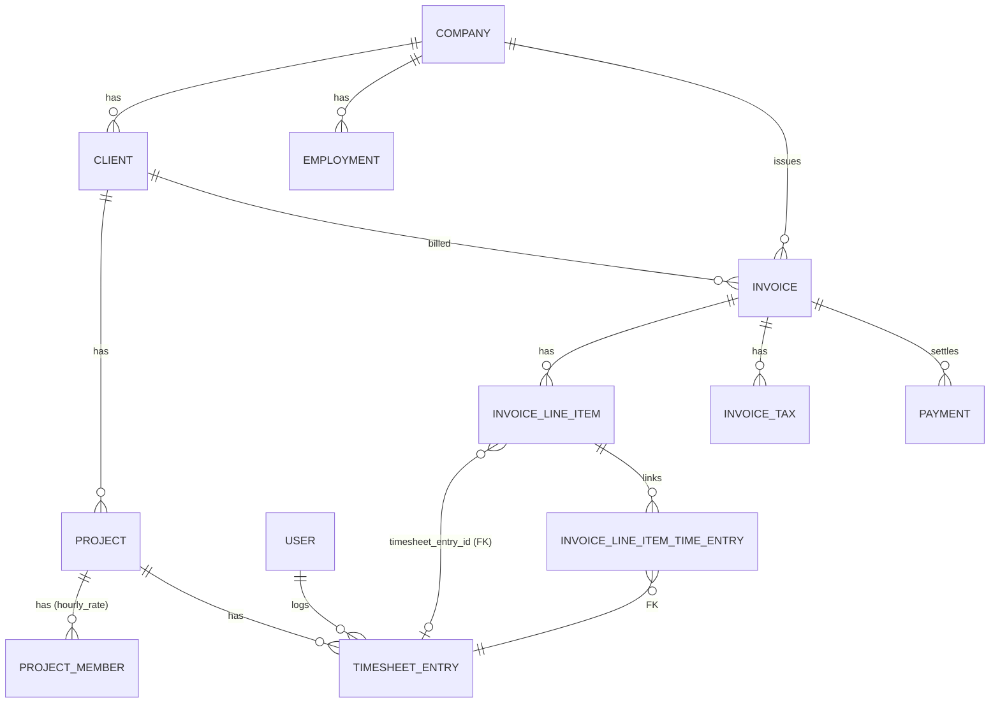
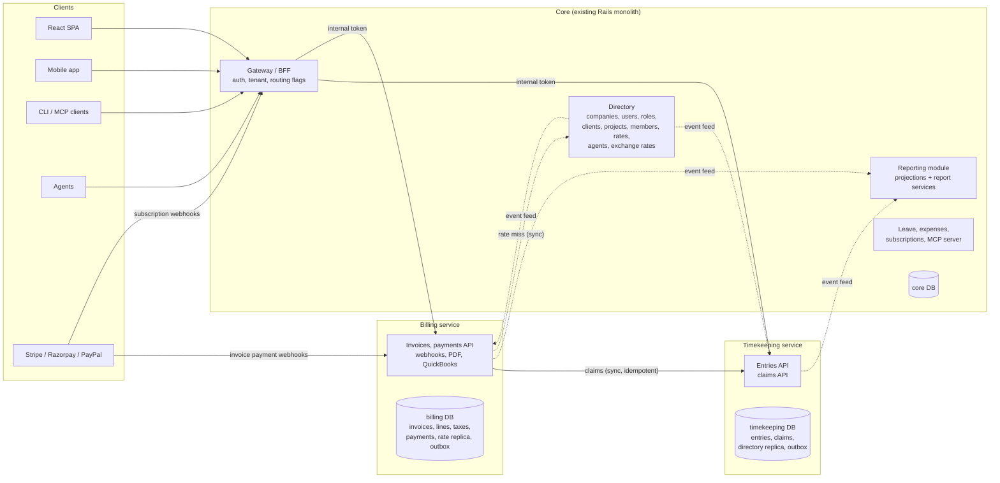
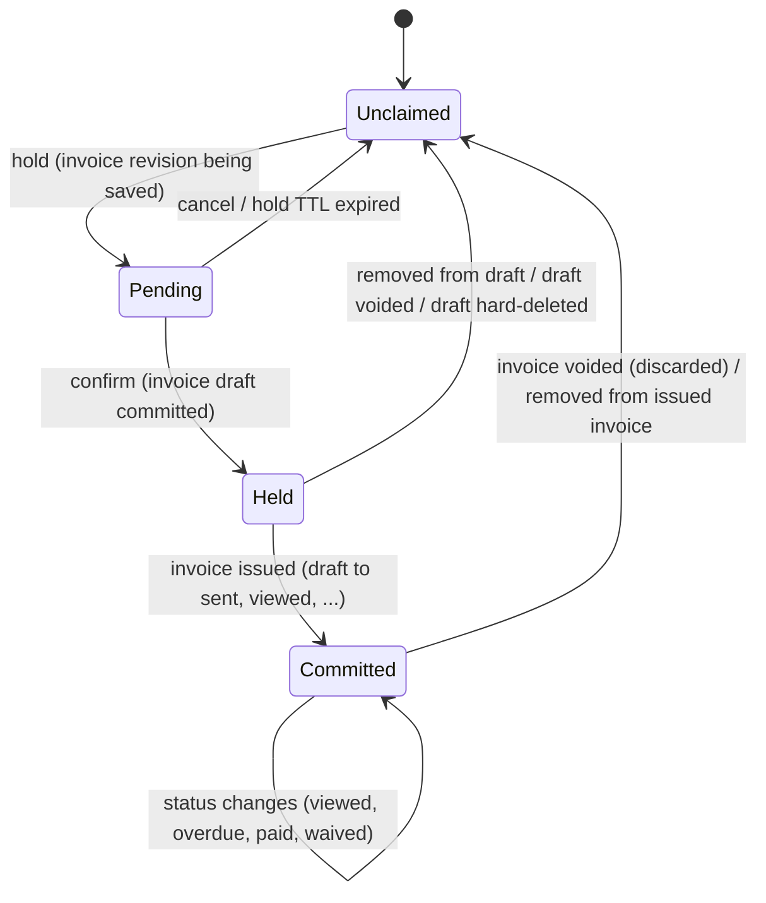
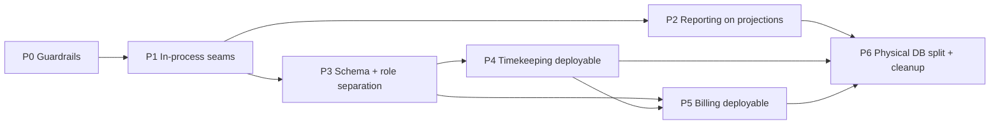
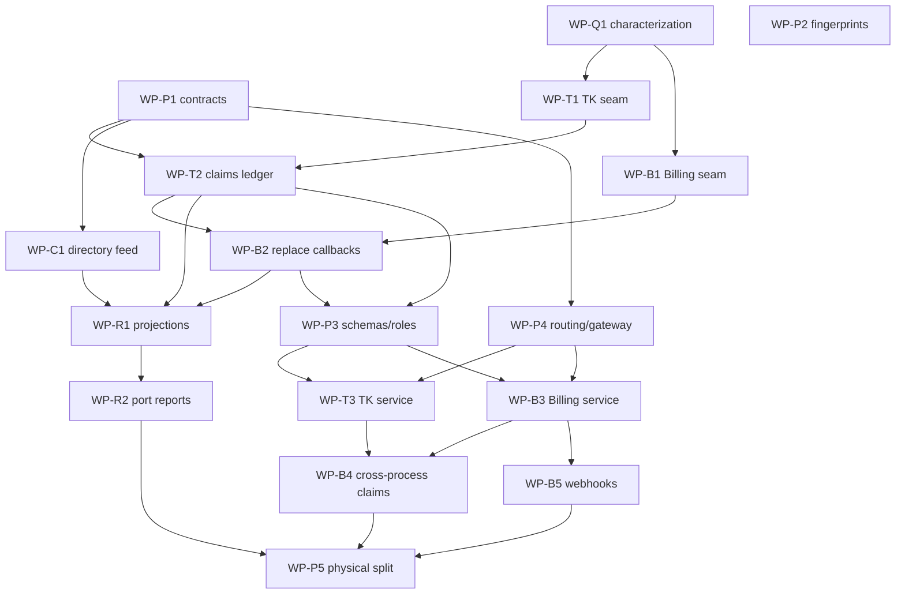

# Cobb Your Dependencies

**Technical design: separating timekeeping from billing and reporting**

| | |
|---|---|
| Status | Proposed — design for review. **Not authorization to implement.** |
| Tracking issue | #3 ("Design only: Cobb Your Dependencies") |
| Code baseline | `main` at `7e8ee91` (Miru at `c2f4a01756e`) |
| Date | 2026-11-10 |
| Scope of this change | This document only. No application code, tests, schema, migrations, dependencies, CI, infrastructure or runtime configuration is changed by it. |

---

## Contents

1. [Summary](#1-summary)
2. [How to read this document](#2-how-to-read-this-document)
3. [The existing architecture](#3-the-existing-architecture)
4. [Behavior: observed, anomalous, assumed, proposed](#4-behavior-observed-anomalous-assumed-proposed)
5. [Target architecture](#5-target-architecture)
6. [Alternatives considered](#6-alternatives-considered)
7. [API and event contracts](#7-api-and-event-contracts)
8. [Tenant isolation, authorization and identity propagation](#8-tenant-isolation-authorization-and-identity-propagation)
9. [Review, locking, billing associations and state transitions](#9-review-locking-billing-associations-and-state-transitions)
10. [Financial precision, rounding and historical invoices](#10-financial-precision-rounding-and-historical-invoices)
11. [Transactions, consistency, retries, duplicates, concurrency and partial failure](#11-transactions-consistency-retries-duplicates-concurrency-and-partial-failure)
12. [Migration, backfill, reconciliation, cutover and rollback](#12-migration-backfill-reconciliation-cutover-and-rollback)
13. [Deployment, configuration and observability](#13-deployment-configuration-and-observability)
14. [Verification strategy](#14-verification-strategy)
15. [Acceptance criteria for the completed migration](#15-acceptance-criteria-for-the-completed-migration)
16. [Implementation sequence and parallel work](#16-implementation-sequence-and-parallel-work)
17. [Risks, open questions and decisions for review](#17-risks-open-questions-and-decisions-for-review)
- [Appendix A — Characterization run](#appendix-a--characterization-run)
- [Appendix B — Table ownership map](#appendix-b--table-ownership-map)
- [Appendix C — Source index](#appendix-c--source-index)

---

## 1. Summary

Miru today is one Rails 8.1 application on one Postgres database. Timekeeping, invoicing and reporting
share tables, ActiveRecord callbacks and SQL joins. The tightest knot is that **billing writes directly
to timekeeping rows**: saving a draft invoice sets `timesheet_entries.locked` from an `after_save`
callback (`app/models/invoice.rb:62,200-202`), line-item deletion clears it
(`app/models/invoice_line_item.rb:10,72-76`), and a (now unreachable) mailer path sets `bill_status`
(`app/mailers/invoice_mailer.rb:4,69-74`). Reporting then joins `invoice_line_items ⋈ invoices ⋈
timesheet_entries` in single SQL statements (`app/services/analytics/team_productivity_analytics.rb:64-72`,
`app/models/project.rb:60-79`).

**Recommendation.**

1. Extract **two** independently deployable services, each the sole owner of its data:
   - **Timekeeping** — time entries, their review status, the user-visible `bill_status` field, the
     edit lock, and a **billing-claims ledger** that records which invoice references which entry.
   - **Billing** — invoices, line items, taxes, payments, payment-provider webhooks, PDFs, QuickBooks
     export, and all invoice money math.
2. Keep **Reporting in the monolith ("Core") as a read-model module**, fed by durable event feeds from
   both services. It is separated from timekeeping and billing by data ownership (it may not read their
   tables), not by a network hop. It is a candidate for later extraction with explicit criteria
   (§6, A2), not now.
3. Everything else stays in **Core**: identity and sessions, workspaces/companies, roles, clients,
   projects, project membership and hourly rates, leave/time-off, expenses, SaaS subscriptions, the MCP
   server, the React SPA and the public `/api/v1` surface (Core acts as gateway/BFF).
4. Replace every cross-domain write with one explicit protocol: **Billing declares, per invoice
   revision, the full set of entries the invoice references; Timekeeping records it as claims and
   derives eligibility and the edit lock from a declared rule table.** Billing never writes a
   timekeeping column again.
5. Migrate in seven phases (P0–P6), each with entry/exit criteria and a rollback, moving **code and
   ownership first and physical data last**. Until P6 every rollback is a routing flip with no data
   movement.

Two characterization findings shape the design and need an owner decision before work starts
(§4.2, §17): the live "send invoice" path never marks entries `billed` (C2, C2b), and discarding a
draft invoice leaves its entries locked (C4). The design preserves both by default and isolates each
in a single, switchable rule.

---

## 2. How to read this document

Every factual claim carries one of these tags:

| Tag | Meaning |
|---|---|
| **[O]** | **Observed** — read in the code at the cited `path:line`, or confirmed by the characterization run in Appendix A (`C#`). |
| **[O-inf]** | Observed structure, but the conclusion is an inference from reading, not executed. |
| **[A]** | **Assumption** — believed true, not verified; each has an owner question in §17. |
| **[P]** | **Proposal / requirement** introduced by this design. |
| **[D-n]** | A **decision** that needs review before the dependent work starts (§17.3). |

Behavior IDs: `B-n` (must preserve), `X-n` (observed anomaly), `C-n` (characterization case).

---

## 3. The existing architecture

### 3.1 Runtime topology [O]

| Concern | Today | Source |
|---|---|---|
| Web | Falcon (`web: bundle exec falcon host`) | `Procfile`, `Dockerfile:142` |
| Worker | Solid Queue (`rake solid_queue:start`), queues `default` and `billing_sync` | `Procfile`, `config/solid_queue.yml`, `config/application.rb:85` |
| Database | One Postgres database per environment; Solid Queue tables live in it | `config/database.yml:1-27`, `db/schema.rb:945-1064` |
| Cache | Redis optional (analytics cache, Solid Cable) | `app/services/analytics/cache_store.rb:53-57` |
| Deploy | Render (`render.yaml`: web, worker, Postgres, Redis) and Kamal (`config/deploy.yml`, `deploy_kamal.sh`) | |
| Health | `GET /health` → DB `SELECT 1` only | `config/routes.rb:11`, `app/controllers/health_controller.rb:8-25` |
| Errors / tracing | Sentry, prod and staging only, `traces_sample_rate = 1.0` | `config/initializers/sentry.rb:3-14` |
| Feature flags | None (ENV booleans only, e.g. `MCP_SERVER_ENABLED`) | `app/controllers/api/v1/mcp_controller.rb:49` |
| Clients | React SPA (`app/javascript`), Expo mobile (`apps/mobile`), CLI, MCP, agent keys | §3.6 |

### 3.2 Domain model and the tenant chain [O]



Facts that constrain the split:

- `timesheet_entries` and `projects` have **no `company_id`**. Tenancy is derived via
  project → client → company: `scope :in_workspace, ->(company) { where(project_id: company&.project_ids) }`
  (`app/models/timesheet_entry.rb:63`; `has_one :company, through: :client` at `:44-45`).
- `invoices.company_id` is **nullable** (`db/schema.rb:590`) though `belongs_to :company` requires it
  (`app/models/invoice.rb:38`).
- Foreign keys cross the future boundary: `invoice_line_items.timesheet_entry_id → timesheet_entries`,
  `invoice_line_item_time_entries.timesheet_entry_id → timesheet_entries` (`db/schema.rb:1281-1284`),
  and `timesheet_entries → projects, users, agents` (`:1325-1327`).
- Column types that matter for money/time: `timesheet_entries.duration float` (minutes);
  `invoice_line_items.quantity integer` (minutes); `invoice_line_items.rate decimal(20,2)`;
  `project_members.hourly_rate decimal` (no precision/scale); invoice and payment amounts
  `decimal(20,2)`; `exchange_rate decimal(18,10)` (`db/schema.rb:554-567,583-622,721-741,767-777,1106-1139`).
- There is **no unique constraint** stopping one entry from appearing on several line items or invoices:
  `invoice_line_items.timesheet_entry_id` has a plain index, and the join table is unique only per
  (line item, entry) pair (`db/schema.rb:549,565-566`). Confirmed by C6.

### 3.3 Timekeeping write paths [O]

| # | Path | Route | Authorization | Notes |
|---|---|---|---|---|
| A | Web + mobile entry CRUD — `Api::V1::TimesheetEntryController` | `/api/v1/timesheet_entry`, `/api/v1/mobile/timesheet_entries` (`config/routes/api.rb:56,76`) | `TimesheetEntryPolicy` (`app/policies/timesheet_entry_policy.rb`) | Project looked up in `current_company.projects.kept` with **no membership check** (`timesheet_entry_controller.rb:60-62`); owner/admin may log for any company user, others only for themselves (`:68-76`); permits `bill_status` (`:79`). |
| B | Bulk move/delete — `TimesheetEntry::BulkActionController` | `PATCH/DELETE /api/v1/timesheet_entry/bulk_action` (`api.rb:58`) | `bulk_update?`/`bulk_destroy?` + own `entry_locked?` (`bulk_action_controller.rb:65-70`) | Treats `billed?` (not `locked`) as locked; uses non-bang `update` and `discard_all` [O-inf]. |
| C | CLI — `Api::V1::Cli::TimesheetEntriesController` | `/api/v1/cli/timesheet_entries` (`api.rb:67`) | Pundit; record looked up via `current_user.timesheet_entries` | Owners cannot edit others' entries over CLI. |
| D | MCP tools `miru.time.{create,update,delete}` | `/mcp` → proxied to C (`app/mcp/tools/*`, `app/mcp/api_proxy.rb`) | Re-enters Rails with caller's Authorization | Idempotency via `MCPIdempotencyRecord` + `pg_try_advisory_lock`, 24 h TTL (`app/mcp/idempotency_store.rb:8-54`). |
| E | Agent API — `Api::V1::Agent::TimesheetEntriesController#create` | `POST /api/v1/agent/timesheet_entries` (`api.rb:90`) | Agent key; no Pundit (`agent/base_controller.rb:7`) | Forces `review_status: pending_review` via model (`timesheet_entry.rb:142-151`); writes `external_run_id`/`external_session_id` with **no dedupe**. |
| F | Harvest import | `POST /api/v1/imports` → `DataImportJob`; rake `imports:harvest_time_entries` | `DataImportPolicy` owner/admin | Slices of 500 per transaction, savepoint per row; creates `billed` rows as `unbilled` then `update!(bill_status: :billed)` (`app/services/imports/harvest_time_entries_importer.rb:388-409,461-477`). |
| G | **Billing writes to entries** | Invoice create/update/destroy, line-item destroy | `InvoicePolicy` owner/admin | `locked` true on every draft save (`invoice.rb:62,200-202`); false on draft discard (`:63,204-206`) and on line-item destroy while draft (`invoice_line_item.rb:10,72-76`); `bill_status: billed` only via `update_timesheet_entry_status!` (`invoice.rb:126-128`). |
| H | Demo seeder | `analytics:seed_demo` | n/a | `app/services/analytics/demo_seeder.rb:162-177`. |

Model rules shared by all paths (`app/models/timesheet_entry.rb`) [O]:

- `bill_status` enum `non_billable | unbilled | billed` (`:14`), defaulted from `project.billable`
  (`:47,132-139`); cannot be created `billed` (`:49,153-155`); an `employee` cannot change it away from
  `billed` (`:50,157-162`); `unbilled` on a non-billable project is invalid (`:59,164-168`).
- `review_status` enum `not_required | pending_review | approved | rejected` (`:15`); agent entries are
  forced to `pending_review` (`:48,142-151`). **No endpoint approves or rejects an entry today** [O].
- `locked` blocks updates **only for the `employee` role** and only when `Current.user` is set
  (`:61,180-186`); jobs, imports and rake tasks bypass it. Confirmed by C7.
- Audited fields exclude `locked` (`:6-7`).
- `has_one :invoice_line_item, dependent: :destroy` (`:43`) — a hard delete of an entry would delete its
  line item, on any invoice [O-inf]; normal deletes are soft (`discard`).

### 3.4 Billing paths that consume time [O]

1. **Selection.** `GET /api/v1/invoices/line_items` (`api.rb:158`) →
   `GenerateInvoice::NewLineItemsService` (`app/services/generate_invoice/new_line_items_service.rb`).
   It returns kept, `unbilled` entries of the client's kept projects, **excluding entries already
   referenced by any kept invoice** (direct or linked) and `selected_entries` (`:34-59`). The
   exclusion query is not company-scoped (`Invoice.kept.pluck(:id)`, `:35`; harmless for correctness
   because the outer query is client-scoped, but a full-table read). `rate` is read live from
   `project_members.hourly_rate` (`app/presenters/project_members_presenter.rb:10-20`). `review_status`
   is **not** filtered, so `pending_review` agent entries are invoiceable (`:54-59`).
2. **Line item creation.** There is no server-side builder: the SPA maps selected rows into nested
   `invoice_line_items_attributes` (`app/javascript/src/components/Invoices/common/utils.js:27-39`)
   permitted by `InvoicePolicy#permitted_attributes` (`app/policies/invoice_policy.rb:48-60`). Line items
   are **snapshots** (own `name`, `description`, `date`, `quantity`, `rate`) plus live references
   `timesheet_entry_id` and `linked_timesheet_entry_ids`. Server validation of references is
   company-match only (`invoice_line_item.rb:56-70`, `invoice_line_item_time_entry.rb:12-17`).
3. **Lock and send.** Draft save locks (C1). `POST /api/v1/invoices/:id/send_invoice` generates the PDF,
   enqueues `InvoiceMailer#send_invoice` and calls `record_send!` (`app/controllers/api/v1/invoices_controller.rb:64-103`,
   `app/models/concerns/invoice_sendable.rb:10-18`); **neither touches `bill_status`** (C2, C2b). The
   `after_action :update_status` that would set `billed` is registered `only: [:invoice]`
   (`invoice_mailer.rb:4`), and `InvoiceMailer#invoice` is reached only through
   `InvoiceSendable#send_to_email`, which has no caller in `app/` [O].
4. **Status transitions.** `draft→sent` (`record_send!`), `sent→viewed` (public view key,
   `app/controllers/api/v1/invoices/view_controller.rb:10`), `sent|viewed→overdue` (daily job,
   `app/services/update_invoice_status_to_overdue_service.rb:5-6`), `→paid` (`Invoice#settle!`,
   `invoice.rb:138-149`), `sent|viewed|overdue→waived` (`invoices/waived_controller.rb:6`,
   rule at `invoice.rb:194-198`), leaving `paid` is blocked (`:184-188`), and `status` is also a
   permitted update attribute (`invoice_policy.rb:50`).
5. **Payments and providers.** Stripe, Razorpay and PayPal webhooks are signature-verified and
   idempotent by provider event id with `with_lock` (except Stripe `checkout.session.expired`, which is
   not idempotent — `app/services/invoice_payment/stripe_checkout_failed.rb:14-15`). One Stripe endpoint
   (`config/routes.rb:84`) handles **both** invoice checkout events and SaaS subscription events
   (`app/services/handle_stripe_checkout_event_service.rb:11-13,45-55`). None of the providers
   reference time entries.
6. **QuickBooks export** reads only invoice/line/payment columns (`app/services/quick_books/mappers/invoice.rb:65-123`).

### 3.5 Reporting reads and the cross-domain joins [O]

Single-statement joins across timekeeping and billing (the hard part):

| # | Location | Join |
|---|---|---|
| J1 | `app/services/analytics/team_productivity_analytics.rb:64-72` | `invoice_line_items ⋈ invoices ⋈ timesheet_entries`, grouped by entry user (revenue per person). Reused by `ComparativeAnalysisService`, `ThresholdEvaluator`, analytics exports. |
| J2 | `app/models/project.rb:60-79` | `invoices ⋈ invoice_line_items WHERE timesheet_entry_id IN (project's kept entries)` (project page receivables). |
| J3 | `app/services/analytics/growth_metrics_service.rb:81-97` | `EXISTS(timesheet_entries ⋈ projects ⋈ clients) OR EXISTS(invoices)` (founder digest). |
| J4 | `app/services/time_entries/filters.rb:41-42`, `app/services/team/removal_impact_service.rb:36-45` | Billing state read from the timekeeping row (`bill_status`). |

Same payload, separate queries (easy to split): `Reports::ClientRevenues::ReportDecorator`
(`app/services/reports/client_revenues/report_decorator.rb:122-168`), `DashboardPresenter`
(`app/presenters/dashboard_presenter.rb`), `Clients::IndexService` (`app/services/clients/index_service.rb:102-110`),
`ProjectSqlQueries` (`app/models/concerns/project_sql_queries.rb:6-39`, cost = duration × hourly rate),
legacy admin `AnalyticsController` (`app/controllers/analytics_controller.rb:88,119`).

Single-domain reads: `TimeTrackingIndexService` (timekeeping + Core time-off/holidays, no billing,
`app/services/time_tracking_index_service.rb:54-58`); `Reports::TimeEntries::ReportService`
(timekeeping only); revenue/aging/payments reports (billing only).

Analytics results are cached 30 min in Redis/`Rails.cache` keyed by company and filters
(`app/services/analytics/cache_store.rb:11-58`); everything else is computed per request. Search is
`pg_search` on live tables — there is no external index to keep in sync (`app/models/concerns/searchable.rb`).

### 3.6 Identity, tenancy and events [O]

- **Authentication order** (`app/controllers/concerns/authenticable.rb:13-67`): session cookie →
  CLI bearer (`CliSession`, digest-stored, sliding expiry, revalidates employment and role,
  `app/models/cli_session.rb:11-49`) → devise-jwt bearer → legacy `X-Auth-Email`/`X-Auth-Token`
  (used by mobile, `apps/mobile/src/api.ts:27-28`). Agents use `AgentKey` bearer tokens
  (`app/models/agent_key.rb:10-31`) and are signed in as `agent.user` with workspace forced to
  `agent.company` (`app/controllers/api/v1/agent/base_controller.rb:14-44`).
- **Tenant resolution**: `current_company` = CLI session company → `current_user.current_workspace` →
  first kept employment (`app/controllers/concerns/current_company_concern.rb:10-18`); copied into
  `Current.user` / `Current.company` (`app/controllers/concerns/set_current_details.rb:7-11`).
  Roles via rolify, checked live per request (`app/policies/application_policy.rb`).
- **Events**: 14 `ApplicationEvent` classes emitted with `Rails.event.notify` inside model callbacks
  (e.g. `timesheet_entry.rb:53`, `invoice.rb:67-71`). The only subscriber is `rails_event_viewer`,
  which writes them synchronously inside the business transaction (`config/initializers/rails_event_viewer.rb:5-24`).
  `docs/ai/events.md:8-12` states they are best-effort observability, **not a delivery queue**. There is
  no outbox.

### 3.7 Dependency matrix (table access today) [O]

| Table | Written by timekeeping code | Written by billing code | Read by reporting code |
|---|---|---|---|
| `timesheet_entries` | A–F, H | **G (`locked`, `bill_status`)** | J1–J4, time reports, dashboard, team, clients, projects |
| `invoices`, `invoice_line_items`, `invoice_line_item_time_entries`, `invoice_taxes` | — | yes | J1, J2, J3, revenue/aging/outstanding reports, dashboard |
| `payments` | — | yes | revenue forecast, payments report, digests |
| `projects`, `project_members` | read (validation, scope) | read (rates) | yes |
| `clients`, `companies`, `users`, `employments`, `roles` | read | read | yes |

---

## 4. Behavior: observed, anomalous, assumed, proposed

### 4.1 Observed behavior that must be preserved [O]

| ID | Behavior | Evidence |
|---|---|---|
| B-1 | Public HTTP routes, request params and JSON shapes under `/api/v1/**`, `/internal_api/v1/**`, `/mcp`, `/webhooks/**` and the public invoice view stay byte-compatible. | `config/routes.rb`, `config/routes/api.rb`; request specs under `spec/requests/**` |
| B-2 | Role rules of `TimesheetEntryPolicy`: owner/admin/employee may create; update/destroy denied if `billed?`, denied for non-privileged users when `work_date` is older than `company.timesheet_edit_days`, otherwise owner/admin of the entry's company or the entry's own user. Scope: owner/admin see all kept entries of the workspace, others their own. | `app/policies/timesheet_entry_policy.rb:4-69`; `spec/policies/timesheet_entry_policy_spec.rb` |
| B-3 | Per-path quirks: web path has no project-membership check; CLI path cannot edit others' entries; agent path forces `pending_review`; bulk path treats `billed?` (not `locked`) as locked. | §3.3 |
| B-4 | `bill_status` defaulting/validation rules (§3.3) and that **billing does not change `bill_status` on send** (C2, C2b). | `timesheet_entry.rb:132-168`; Appendix A |
| B-5 | Saving a draft invoice locks every entry it references (C1); removing a line item from a draft unlocks its entries (C9); locks block only employees (C7). | `invoice.rb:62,200-202`; `invoice_line_item.rb:72-76` |
| B-6 | Selection eligibility: kept, `unbilled`, on the client's kept projects, not referenced by any kept invoice; entries of discarded invoices become eligible again (C10). `review_status` does not affect eligibility. | `new_line_items_service.rb:34-59` |
| B-7 | Line items are snapshots; rate comes from `project_members.hourly_rate` at selection time; entry `duration` (float) is truncated into integer `quantity` (C5). | §3.4; Appendix A |
| B-8 | Invoice money math exactly as today: subtotal = Σ(`quantity`/60 × `rate`) in Float rounded to 2 dp; total = (subtotal − discount + tax) rounded to 2 dp; tax amounts recomputed only while draft; `base_currency_amount = (amount × rate).round(2)` with rate fixed at issue date; line `total_cost` rounds to 3 dp with Float×BigDecimal arithmetic (C8). | `invoice.rb:226-349`; `invoice_line_item.rb:20-48`; `app/models/invoice_tax.rb:21-42` |
| B-9 | Stored amounts of non-draft invoices and recorded payments are never recomputed; historical PDFs render from the same code path (which recomputes subtotal for display, `app/services/pdf_generation/invoice_service.rb:46-54`). | §10 |
| B-10 | Invoice status transitions and their guards (§3.4 item 4); invoice numbers unique per company; discard renames to `ARC-<id>-<number>` (`invoice.rb:95,323-325`). | |
| B-11 | Payment-provider idempotency by provider event id; Stripe/Razorpay/PayPal webhook URLs unchanged. | §3.4 item 5 |
| B-12 | Report numbers (values, rounding, currency choice — including today's known inconsistencies in §4.2) are identical before and after each report moves to projections. | `spec/services/analytics/**`, `spec/services/reports/**`, `spec/requests/api/v1/reports/**` |
| B-13 | Audit history (`audits` table) for entries, invoices and payments remains queryable through the audit-log API. | `app/models/timesheet_entry.rb:6-7`; `app/controllers/api/v1/audit_logs_controller.rb` |
| B-14 | MCP write tools remain idempotent with the same key semantics. | `app/mcp/idempotency_store.rb` |
| B-15 | Record ids (`timesheet_entries.id`, `invoices.id`, …) are stable; they appear in URLs, audits, QuickBooks references and client caches. | |

### 4.2 Observed anomalies (preserved by default; each needs a decision) [O]

| ID | Anomaly | Evidence | Default in this design | Decision |
|---|---|---|---|---|
| X-1 | Sending an invoice through the live UI/API path never sets entries to `billed`; only dead code (`InvoiceMailer#invoice` via unused `send_to_email`) does. Team removal-impact "invoiced entries" therefore counts only manually/import-billed entries (`removal_impact_service.rb:45`). | C2, C2b, C3 | Preserve: Billing never writes `bill_status`. Remove the dead path in P1 (no behavior change). | D-1 |
| X-2 | Discarding a **draft** invoice leaves its entries locked: `after_discard :unlock_timesheet_entries` runs, then `after_discard :update_invoice_number` calls `update`, whose `after_save :lock_timesheet_entries, if: :draft?` re-locks them. The entries are simultaneously eligible for a new invoice (C10). | C4, C4-cause; `invoice.rb:62-64,323-325` | Preserve via one rule row in the lock rule table (§9.3), switchable. | D-2 |
| X-3 | One entry can be referenced by several line items on several invoices; nothing in the DB prevents double invoicing; only the selection UI filters it. | C6; `db/schema.rb:549,565-566` | Record and report, do not enforce, until D-3. | D-3 |
| X-4 | Fractional minutes are truncated on invoicing (90.7 min → 90). | C5 | Preserve. | D-5 |
| X-5 | Two arithmetic paths for line totals (Float in invoice totals, Float×BigDecimal in `total_cost`) disagree at the third decimal. | C8 | Preserve both, move into one pure module with golden tests. | D-5 |
| X-6 | Report inconsistencies: dashboard sums `invoices.amount` without base conversion; several expense aggregates use `amount` not `base_currency_amount`; client-revenue per-row vs summary totals differ; accounts-aging lacks `.kept`. | `app/presenters/dashboard_presenter.rb:92-255`; `app/services/analytics/comparative_analysis_service.rb:104`; `app/services/reports/client_revenues/report_decorator.rb:98,136`; `app/services/reports/accounts_aging/fetch_overdue_amount.rb:51-55` | Port verbatim; fixing is out of scope of this migration. | D-6 |
| X-7 | Entries added to an invoice after it leaves draft are never locked (`after_save … if: :draft?`). | `invoice.rb:62` [O-inf] | Preserve via lock rule table. | D-2 |
| X-8 | `InvoiceLineItem#unlock_timesheet_entries` unlocks an entry even if another draft invoice still references it (only possible because of X-3). | `invoice_line_item.rb:72-76` [O-inf] | Preserve; disappears if D-3 enforces single reference. | D-3 |

### 4.3 Assumptions [A]

| ID | Assumption | How it will be checked |
|---|---|---|
| A-1 | Production volume fits comfortably in one Postgres cluster for the foreseeable future; the split is driven by ownership and deploy independence, not scale. | Owner confirmation; `pg_stat_statements` review (PgHero is mounted, `config/routes.rb:22-24`). |
| A-2 | No external integrator reads Miru's database directly. | Owner confirmation. |
| A-3 | Production contains some X-3 duplicates and X-2 locked-but-unreferenced entries. | P0 data audit queries (§12.3). |
| A-4 | Reporting staleness of ≤ 5 s (p99) is acceptable for cross-domain pages (team productivity, project receivables, growth digest). | Product sign-off (D-7). |
| A-5 | Stripe invoice-checkout events can be routed by a separate webhook endpoint (multiple endpoints per account are standard Stripe functionality); whether connected-account events need special handling is unverified. | Spike in WP-B5. |
| A-6 | Playwright specs (`spec/e2e/*.spec.ts`, `tests/*.spec.ts`) are not run in CI (`.github/workflows/validations.yml`) and need a harness before they can gate releases. | Observed workflow; confirm no external runner. |

### 4.4 Proposed requirements [P]

- R-1 Each service is the only writer of its tables; enforced by database roles, not convention.
- R-2 No synchronous call chain longer than one hop on any user request (Core → service).
- R-3 Every mutating internal call is idempotent by key; every event is delivered at-least-once and
  consumed idempotently by `(aggregate, version)`.
- R-4 Any phase can be rolled back by configuration until P6.
- R-5 Money is transported as decimal strings, never JSON floats.
- R-6 Every service-owned row carries `company_id`; every query is company-scoped and verified by tests.

---

## 5. Target architecture

### 5.1 Picture



Solid arrows are synchronous HTTP; dotted arrows are pull-based event feeds (§7.5).

### 5.2 Service responsibilities and authoritative data

| Service | Owns (single writer) | Exposes | Depends on |
|---|---|---|---|
| **Timekeeping** | `timesheet_entries` (+ new `company_id`, `lock_version`), `billing_claims`, `tk_idempotency_keys`, `tk_outbox`, read-only directory replica (`tk_dir_*`) | Entry CRUD (all paths A–F, H), time-tracking list, bulk actions, entry aggregates (minutes by project/client/user), claimable-entries query, claims API, event feed | Core directory feed; internal token keys |
| **Billing** | `invoices`, `invoice_line_items` (+ `project_id`, `user_id`, `entry_snapshot`), `invoice_line_item_time_entries`, `invoice_taxes`, `tax_configurations`, `payments`, `payments_providers`, `stripe_connected_accounts`, `razorpay_payouts`, `quickbooks_*`, `bulk_invoice_download_statuses`, `bl_outbox`, `bl_idempotency_keys`, rate replica | Invoice/line-item/payment APIs, invoice view by external key, PDF, provider webhooks, QuickBooks export, receivables aggregates, event feed | Timekeeping claims + claimable query; Core directory feed; Core exchange-rate API on miss |
| **Core** | Users, sessions, CLI sessions, agent keys, roles, companies, employments, clients, client members, projects, project members and **hourly rates**, exchange rates, leave/time-off/holidays, expenses, subscriptions, analytics reports, audits (historic), `rpt_*` projections, `service_routes` | Public API (gateway), directory feed and APIs, exchange-rate API | Both service APIs and feeds |

Why these boundaries:

- **Timekeeping** is defined by one aggregate (the entry) with many writers (six paths) and one hard
  invariant shared with billing: "an invoiced entry cannot be edited by an employee and is not offered
  for invoicing again." Putting the claims ledger *inside* Timekeeping makes that invariant a local
  transaction (edit and claim checks lock the same row), instead of a distributed one.
- **Billing** is defined by money, external payment providers, and its own lifecycle (draft → sent →
  paid). It consumes time as snapshots; it already copies `name`, `date`, `quantity`, `rate` onto line
  items (B-7), so most of its dependency on live entries is already gone. What remains is the claim.
- **Projects, clients and rates stay in Core** because they are edited together in one screen
  (project + members + rates), are referenced by expenses and leave as well, and are the tenant
  backbone. Moving them into Timekeeping would make Billing depend on Timekeeping for rates and client
  data; moving them into Billing would make Timekeeping depend on Billing for project validity. Core
  publishes them; both services hold read-only replicas.
- **Reporting stays in Core** because its value is joining data from all domains. As a separate
  service it would replicate the same three feeds Core already replicates and add a deployable with
  no write authority of its own. Its separation is enforced by data access: reporting code may read
  only `rpt_*` projections and Core tables (R-1, CI check in §14).
- **Time-off / leave stays in Core** (it is HR data, not billed time). The time-tracking page composes
  entries (Timekeeping) with time-off and holidays (Core) in the BFF.

### 5.3 What remains in the monolith, explicitly

Authentication (Devise, JWT, OTP, passkeys, TOTP, SSO), CLI and agent credential issuance and
verification, workspaces and roles, clients and client portal membership, projects, project members
and rates, employments, leave/time-off/holidays/carryovers, expenses, SaaS subscriptions and the
subscription half of the Stripe webhook, analytics/reporting (on projections), notifications and
digests, MCP server (its tools call the gateway exactly as today), admin, the SPA and the mobile API.

---

## 6. Alternatives considered

| # | Alternative | Verdict | Reason |
|---|---|---|---|
| A1 | **Modular monolith only** (Rails engines/packs, one DB, one deploy). | Rejected as end state; **adopted as P1**. | The issue requires independent deployment and explicit data ownership; packs alone give neither. But the seams must exist in-process first, so it is the first phase. |
| A2 | **Three services** (Timekeeping, Billing, Reporting). | Deferred. | Reporting has no write authority and needs every domain's data; extracting it duplicates replication and adds a deployable without reducing coupling. Re-evaluate when any of: report queries exceed 20 % of Core DB time; reporting needs a different store (columnar); or a separate team owns it. The `rpt_*` projections make that extraction mechanical later. |
| A3 | **Billing-only extraction** (timekeeping stays in Core). | Rejected. | Leaves the entry-lock invariant split between Core and Billing anyway, and does not separate timekeeping from reporting. Same protocol cost, half the benefit. |
| A4 | **Timekeeping owns projects, clients and members.** | Rejected. | Makes Billing depend on Timekeeping for client/rate data and moves the tenant backbone out of Core where expenses/leave also need it (§5.2). |
| A5 | **Claims owned by Billing** (Billing tells Timekeeping "lock/unlock entry"). | Rejected. | The edit-lock check happens on entry update, inside Timekeeping. If Billing owned claims, every entry edit would need a synchronous call to Billing, or the lock would be eventually consistent and an employee could edit an entry that was just invoiced. |
| A6 | **Shared database with schema separation forever.** | Partially adopted (P3–P5). | Schemas + roles give ownership; separate databases (P6) remove the shared failure and upgrade domain. P6 is planned but can be postponed without losing the other benefits. |
| A7 | **Message broker** (Kafka / SQS / NATS) instead of HTTP feeds. | Rejected for now. | Adds infrastructure that does not exist today (§3.1). A transactional outbox exposed as a cursor-paged HTTP feed gives at-least-once delivery, replay and backfill with the existing Postgres + Solid Queue stack. The envelope (§7.5) is broker-neutral, so a broker can be added behind the relay later. |
| A8 | **Event-sourced time ledger.** | Rejected. | Large rewrite of every write path with no requirement that needs it; audits already provide history. |
| A9 | **Distributed transactions / 2PC between Billing and Timekeeping.** | Rejected. | Not supported by the stack; a reservation (hold → confirm/release) with idempotent retries gives the needed guarantee (§11.2). |

---

## 7. API and event contracts

All payloads below are illustrative design material.

### 7.1 Conventions [P]

- **Versioning.** Internal APIs are path-versioned (`/internal/v1/...`). Within a version, changes are
  additive only (new optional fields, new endpoints). Removing or changing a field requires `/v2`, run
  side by side for at least two releases of every consumer. Events carry `type` with a version suffix
  (`timekeeping.time_entry.upserted.v1`); consumers ignore unknown fields and unknown types.
- **Public API compatibility.** Public routes do not change (B-1). Core keeps the existing controllers
  as thin adapters: authenticate, resolve tenant, mint internal token, forward, and render with the
  existing jbuilder views where shapes are derived (see §12 P4 "adapter parity" tests).
- **Headers.** `Authorization: Bearer <internal token>` (§8), `Idempotency-Key` (required on every
  mutating internal call), `X-Request-Id` (propagated from the edge), `traceparent`/`sentry-trace`.
- **Errors.** `application/problem+json` with stable `type` URIs, e.g.
  `…/errors/entry-locked`, `…/errors/stale-entry`, `…/errors/claim-conflict`,
  `…/errors/idempotency-key-reused`. Core maps them back to today's public error JSON
  (`app/controllers/concerns/error_handler.rb:7-10`).
- **Money and time.** Money as decimal strings with the column's scale (`"150.00"`). Durations as the
  stored minute value; for the float column it is serialized with Ruby's shortest round-trip
  representation and documented as such (R-5, §10.2).
- **Pagination.** Opaque cursors; feeds use a numeric `position` cursor.

### 7.2 Timekeeping API [P]

Public-equivalent (called by Core gateway, one per existing write path so B-3 quirks are preserved):

```
POST   /internal/v1/entries                  # paths A, mobile   (body: project_id, user_id?, duration, work_date, note, bill_status)
PATCH  /internal/v1/entries/{id}
DELETE /internal/v1/entries/{id}             # soft delete (discard)
PATCH  /internal/v1/entries/bulk             # path B: { ids, project_id }
DELETE /internal/v1/entries/bulk             # path B
POST   /internal/v1/cli/entries              # path C (and MCP via C)
PATCH  /internal/v1/cli/entries/{id}
DELETE /internal/v1/cli/entries/{id}
POST   /internal/v1/agent/entries            # path E (external_run_id, proof_* …)
POST   /internal/v1/imports/harvest/batches  # path F, called by Core's DataImportJob in 500-row batches
GET    /internal/v1/entries?from&to&user_id&project_ids&status&cursor   # time tracking, reports
GET    /internal/v1/aggregates/minutes?group_by=project|client|user&from&to&filters…
```

Billing-facing:

```
GET /internal/v1/claimable-entries?client_id=&project_ids[]=&filters…&exclude_ids[]=&cursor=
  -> { entries: [ { id, project_id, user_id, work_date, duration, note, bill_status,
                    review_status, version } ], next_cursor }
```

Returns exactly B-6: kept, `unbilled` (unless the `status` filter overrides it, as today —
`time_entries/filters.rb:41-43` merged after defaults), on the given kept projects, and **with no
active claim**. Rates are not returned; Billing joins its rate replica.

```
PUT /internal/v1/billing-claims/{invoice_id}
Idempotency-Key: claim:{invoice_id}:{revision}
{
  "company_id": 42,
  "invoice_id": 9001,
  "revision": 7,                 // Billing's invoice lock_version; monotonic
  "invoice_state": "draft",      // draft | issued | void | deleted
  "entry_ids": [101, 102, 205],  // full set referenced by the invoice at this revision
  "phase": "hold"                // hold | confirm | cancel  (see §11.2)
}
-> 200 {
  "applied_revision": 7,
  "claims": [ { "entry_id": 101, "state": "held", "version": 14, "locked": true } , … ],
  "conflicts": [ { "entry_id": 205, "other_invoice_ids": [8800] } ]   // reported, not enforced until D-3
}
```

Set-replace semantics: the request states the whole truth for one invoice at one revision; requests
with `revision` lower than the stored one are acknowledged and ignored (out-of-order safe).
`invoice_state` lets Timekeeping evaluate the lock rule table (§9.3) without knowing invoice internals.

```
GET /internal/v1/billing-claims?invoice_id=…            # reconciliation
GET /internal/v1/billing-claims?entry_id=…              # support tooling
```

### 7.3 Billing API [P]

Public-equivalent (Core forwards the existing routes): invoices CRUD, `send_invoice`,
`send_reminder`, `download`, `waived`, `bulk_deletion`, `bulk_download`, `line_items` (selection —
Billing calls `claimable-entries` and joins rates), `payments`, `razorpay_payment_link`,
`quickbooks_sync`, invoice analytics, invoice view by `external_view_key` (unauthenticated, as today).

Aggregates for Core pages:

```
GET /internal/v1/receivables?client_id=…            # client overdue/outstanding (InvoiceAmountsSummary)
GET /internal/v1/receivables?company_id=…           # company overdue/outstanding/draft
```

Webhooks (public, unauthenticated, signature-verified; same URLs, routed at the edge — §13.2):
`/webhooks/razorpay/*`, `/webhooks/paypal/*`, and the invoice half of Stripe (§12 P5, A-5).

### 7.4 Core directory API [P]

```
GET /internal/v1/directory/projects/{id}            # read-through on replica miss
GET /internal/v1/directory/companies/{id}
GET /internal/v1/exchange-rates?from=EUR&to=USD&date=2026-11-10   # Core is the single rate writer
```

### 7.5 Event feeds [P]

Each service (and Core) writes events to an outbox table **in the same transaction** as the state
change. A single relay per service (Solid Queue job holding an advisory lock) assigns a gap-free
`position` in commit order to newly committed rows. Feeds expose only positioned rows, so a consumer
can never skip an event committed late with a lower primary key.

```
GET /internal/v1/feed?after=123456&limit=500
-> { "events": [ <envelope>, … ], "next_after": 123956, "high_watermark": 124002 }
```

Envelope:

```json
{
  "event_id": "0b6c4f9e-…",
  "type": "timekeeping.time_entry.upserted.v1",
  "position": 123457,
  "company_id": 42,
  "aggregate": { "type": "time_entry", "id": 101, "version": 14 },
  "occurred_at": "2026-11-10T18:22:03.120Z",
  "actor": { "type": "user", "id": 7, "agent_id": null, "source": "cli" },
  "request_id": "…",
  "data": { "…": "full current state of the aggregate" }
}
```

Events are **state-carrying** (full aggregate state + version), so consumers upsert and discard
anything older than what they hold. That makes duplicates and reordering harmless and lets a consumer
rebuild from position 0.

| Producer | Event types (v1) |
|---|---|
| Timekeeping | `time_entry.upserted` (create/update/discard/undiscard, includes `bill_status`, `review_status`, `locked`, `discarded_at`), `billing_claim.changed` |
| Billing | `invoice.upserted` (header, totals, status, lines with `entry_ids`, `project_id`, `user_id`), `payment.upserted` |
| Core | `company.upserted` (`base_currency`, `timesheet_edit_days`, time zone), `user.upserted`, `employment.upserted`, `client.upserted`, `project.upserted` (`billable`, `discarded_at`), `project_member.upserted` (incl. `hourly_rate`), `agent.upserted`, `exchange_rate.upserted` |

Existing `Rails.event.notify` calls stay as they are (observability, B-1 for the event viewer); the
outbox is a separate, durable mechanism.

---

## 8. Tenant isolation, authorization and identity propagation

### 8.1 Identity propagation [P]

All end-user, CLI, MCP, mobile and agent traffic still authenticates in Core exactly as today
(§3.6). Core then mints a **per-request internal token** (JWT, EdDSA, 60 s TTL) for each downstream
call:

```json
{
  "iss": "miru-core", "aud": "timekeeping", "exp": …, "jti": "…",
  "sub": "user:7",
  "company_id": 42,
  "roles": ["employee"],                 // rolify roles on company 42, read live at mint time
  "actor": { "type": "user|agent|system|webhook", "agent_id": 3, "auth": "session|jwt|cli|x_auth|agent_key" },
  "source": "web|mobile|cli|mcp|agent|harvest_import",
  "request_id": "…"
}
```

Because the token is minted per request from live role data, role revocation takes effect on the
next request — the same freshness as today's per-request `has_role?` checks. Services verify the
signature against Core's published public keys (JWKS, rotated with overlap), check `aud`, `exp`, and
reject tokens whose `company_id` disagrees with the target resource.

`actor.type = "system"` replaces today's `Current.user == nil` case (jobs, imports, rake tasks), and
the model-level checks that are skipped today when `Current.user` is nil (`timesheet_entry.rb:157-162,180-186`)
are skipped for system actors — preserving B-5 exactly.

Service-to-service calls (Billing → Timekeeping claims) carry a service token (`sub: "service:billing"`)
**plus** the originating user's claims in `act` (RFC 8693 style), so Timekeeping can audit who caused a
lock.

### 8.2 Authorization [P]

- Policies move with their data: `TimesheetEntryPolicy` and the bulk/CLI/agent controller rules move
  to Timekeeping verbatim; `InvoicePolicy`, `InvoiceLineItemPolicy`, `PaymentPolicy` move to Billing.
  They read roles from the token instead of rolify, through a small `RoleSource` interface so the
  existing policy specs can run against both.
- Core keeps a coarse gate (authenticated, tenant resolved, pro-access where required) and never
  decides domain permissions for data it does not own.
- Policy specs (`spec/policies/timesheet_entry_policy_spec.rb`, `invoice_policy_spec.rb`,
  `invoice_line_item_policy_spec.rb`, `payment_policy_spec.rb`) are ported first and run unchanged
  against the in-process interface in P1, then against the service in P4/P5.

### 8.3 Tenant isolation [P]

- **Every** service-owned row gets `company_id` (backfilled for `timesheet_entries` from
  project → client → company, §12.2) and every query is scoped by it, using the token's company.
- Defense in depth: Postgres **row-level security** on service tables, with policies
  `USING (company_id = current_setting('app.company_id')::bigint)`, set per transaction by the
  service. System jobs that legitimately span tenants (overdue job, reconciliation) use a separate
  role with `BYPASSRLS`, audited.
- Feeds are global (one cursor per consumer) but every envelope carries `company_id`; projections are
  tenant-scoped at write.
- The public invoice view by `external_view_key` remains unauthenticated (B-1) and is served by
  Billing; Core forwards without a user token.
- A cross-tenant test suite (§14.3) proves that every internal endpoint rejects resources from
  another company.

---

## 9. Review, locking, billing associations and state transitions

### 9.1 Ownership [P]

| Concept | Owner | Writers | Notes |
|---|---|---|---|
| `review_status` | Timekeeping | Entry writers (agent path forces `pending_review`); future approve/reject endpoints | No approve/reject exists today (§3.3). Billing does **not** filter on it (B-6) unless D-4 changes that. |
| `bill_status` | Timekeeping | Users/API/import as today | Billing never writes it (X-1, D-1). |
| `locked` | Timekeeping | **Only** the lock rule interpreter (§9.3) reacting to claims | Enforcement unchanged (employee-only, B-5). |
| Claims (entry ↔ invoice references) | Timekeeping (ledger) | Billing via `PUT billing-claims` only | Billing's line items remain the authoritative record of *what was invoiced* (snapshots); claims are the authoritative record of *which entries are spoken for*. |
| Line items and snapshots | Billing | Billing | Gains `project_id`, `user_id`, `entry_snapshot` (duration, work_date, note, version) at claim time, removing reporting's need to join live entries for revenue by person/project. |

### 9.2 Entry and claim state [P]



- *Eligibility* (B-6): an entry is claimable iff it has no claim in `Pending`, `Held` or `Committed`.
  Today's rule — "not on any kept invoice" — maps exactly: kept draft ⇒ `Held`, kept non-draft ⇒
  `Committed`, discarded ⇒ released.
- `Pending` exists only for the duration of an invoice save (§11.2) and has a TTL (default 10 min).
  Pending claims make entries ineligible but do **not** change `locked`, so a failed save leaves no
  user-visible trace once the TTL passes.

### 9.3 The lock rule table [P]

`locked` stays a stored column in Timekeeping. It is seeded from today's value at backfill (so X-2
residue carries over unchanged) and afterwards is mutated **only** by one interpreter that maps
(claim transition, invoice state) to a lock effect. The rules are data; the **compat** set
reproduces today exactly, the **corrected** set is what D-2 would approve.

| Transition reported by Billing | Today (code) | `compat` effect | `corrected` effect |
|---|---|---|---|
| Entry enters a claim, invoice `draft` | `after_save :lock_timesheet_entries, if: :draft?` (C1) | lock | lock |
| Any save of a `draft` invoice (entries unchanged) | same callback re-locks all | lock all referenced | lock all referenced |
| Entry leaves a claim, invoice `draft` (line removed, or invoice hard-deleted) | `InvoiceLineItem#unlock_timesheet_entries` (C9) | unlock | unlock **unless still claimed elsewhere** |
| Invoice `draft` → `void` (discard) | unlock then re-lock by renumbering save (C4) | **no change (stays locked)** — X-2 | unlock |
| Entry enters a claim, invoice issued | callback skipped (X-7) | no change | lock |
| Invoice issued → `void` | no unlock (C4b) | no change | unlock |
| Invoice `draft` → issued, or issued → other issued states | no effect | no change | no change |

The interpreter is one function over this table, so all lock branching lives in one place.
Switching sets is a per-company configuration value, so the correction can be rolled out and
rolled back like any other flag.

### 9.4 Billing associations [P]

- Billing keeps `invoice_line_items.timesheet_entry_id` and `invoice_line_item_time_entries` as
  **plain ids** (FKs to `timesheet_entries` dropped in P3), plus the new snapshot columns.
- Every Billing transaction that changes which entries an invoice references, or changes its state
  between draft / issued / void / deleted, produces exactly one claims declaration for the new
  revision (§11.2). That is the **only** coupling point; it replaces `Invoice#lock_timesheet_entries`,
  `#unlock_timesheet_entries`, `#update_timesheet_entry_status!` and
  `InvoiceLineItem#unlock_timesheet_entries`.
- Entry discard after invoicing: today an entry can be discarded while on an invoice (discard skips
  validations [O-inf]); the line item keeps its snapshot. Preserved. Timekeeping emits
  `time_entry.upserted` with `discarded_at`; reporting applies today's `.kept` filters (J2) on the
  projection.

---

## 10. Financial precision, rounding and historical invoices

### 10.1 Rules [P]

1. **Billing is the only place money is computed** for invoices. Timekeeping never computes money.
2. The current formulas (B-8) are extracted unchanged into one pure module, `Billing::Totals`
   (inputs: line quantities, rates, discount, taxes, paid amount, status; outputs: subtotal, tax,
   amount, amount_due, outstanding_amount), including the Float arithmetic and both rounding points.
   `Billing::LineCost` holds the 3-dp `total_cost` path separately (X-5). Golden tests pin outputs for
   a generated corpus plus a production sample (§14.2).
3. Changing the arithmetic (e.g. BigDecimal throughout, or keeping fractional minutes) is a separate,
   decided change (D-5), shipped with a diff report of every open draft it would alter. It never
   alters non-draft invoices.
4. **Quantity conversion** from entry duration (float minutes) to line quantity (integer minutes)
   stays in Billing with today's truncation (C5, X-4). Timekeeping returns the stored float.

### 10.2 Transport [P]

- Money: decimal strings at column scale (`"150.00"`, rates `"0.9200000000"`). Parsed with
  `BigDecimal`, never `Float`.
- Durations: JSON numbers produced by Ruby `Float#to_s` (shortest round-trip). A contract test asserts
  `parse(serialize(x)) == x` for a corpus that includes values like `90.7`, `0.1`, `479.99999`.

### 10.3 Currency and exchange rates [P]

- Core remains the single writer of `exchange_rates` (it already fetches and persists them,
  `app/services/currency_conversion_service.rb:11-34`, `app/models/exchange_rate.rb:15-37`).
- Billing keeps a replica fed by `exchange_rate.upserted`; on a miss it calls Core's rate API
  synchronously (the same failure mode as today's external fetch on miss).
- `invoices.exchange_rate`, `exchange_rate_date` and `base_currency_amount` are fixed at
  computation time exactly as today (`invoice.rb:327-349`) and travel with invoice events, so
  reporting never re-converts.

### 10.4 Historical invoices [P]

- No migration step recomputes `amount`, `amount_due`, `amount_paid`, `outstanding_amount`, `tax`,
  `discount`, `base_currency_amount`, `exchange_rate` or any payment amount. Data moves as
  `numeric → numeric` (logical replication or `COPY`), never through Ruby floats.
- Billing must suppress the `before_validation :calculate_amounts` / `calculate_base_currency_amount`
  triggers on any migration write (there should be none: data is moved, not saved through models).
- A **financial fingerprint** is computed before and after every phase that touches billing data:
  per company and per currency, `count(*)`, `sum(amount)`, `sum(amount_paid)`, `sum(amount_due)`,
  `sum(base_currency_amount)`, `sum(tax)`, `sum(discount)` for invoices by status and discarded flag;
  the same for payments by status; plus a SHA-256 over `(id, amount, base_currency_amount, status,
  updated_at)` ordered by id. Exit criteria require exact equality (§15).
- PDFs: the PDF code path (`InvoicePayment::PdfGeneration`, `app/services/pdf_generation/invoice_service.rb`)
  moves to Billing unchanged; a byte-level text comparison of rendered PDFs for a sample of historical
  invoices (text extracted, timestamps masked) is part of P5 exit.

---

## 11. Transactions, consistency, retries, duplicates, concurrency and partial failure

### 11.1 Transaction boundaries [P]

| Operation | Today | Target |
|---|---|---|
| Entry create/update/discard | One AR transaction | One Timekeeping transaction: entry row (`SELECT … FOR UPDATE`, `lock_version`) + audit + outbox row |
| Draft invoice save | One AR transaction: invoice, lines, taxes, **entry locks** | Billing: hold (sync) → Billing transaction (invoice, lines, taxes, outbox, `claims_pending` marker) → confirm (sync, retried from outbox if it fails) |
| Invoice send | `record_send!` transaction; mail via job | Billing transaction (status, `sent_at`, outbox incl. claims declaration with `invoice_state: issued`) ; mail via Billing's job |
| Payment webhook | `with_lock` on invoice | unchanged inside Billing |
| Harvest import | 500-row transactions | Core job parses CSV and calls Timekeeping batch endpoint per 500 rows; each batch one Timekeeping transaction, idempotent by `import_id:batch_no` |

### 11.2 The claim protocol (reservation with idempotent confirm) [P]

```
Billing.save_invoice(cmd):
  rev = invoice.lock_version + 1
  r1 = Timekeeping.PUT billing-claims/{id}  {phase: hold, revision: rev, entry_ids, invoice_state}
       Idempotency-Key: claim:{id}:{rev}:hold
       -> entries now Pending for this invoice (TTL 10 min); conflicts reported
  BEGIN (billing db)
    write invoice, lines (+snapshots from r1), taxes; lock_version = rev
    insert outbox(claims.confirm {id, rev})
  COMMIT
  relay delivers claims.confirm -> Timekeeping.PUT {phase: confirm, revision: rev}
       Idempotency-Key: claim:{id}:{rev}:confirm      (retried until 2xx)
  on rollback: best-effort PUT {phase: cancel}; otherwise TTL expiry cancels
```

- **Why hold first:** it reproduces today's guarantee that entries are spoken for before the invoice
  is visible, and makes the selection screen exclude them immediately (B-6).
- **Confirm is asynchronous but immediate**: the relay runs right after commit; the user-visible
  `locked` flips at confirm. Between commit and confirm (normally < 1 s) an employee edit would still
  be allowed; today the lock is in the same transaction. Mitigation: Timekeeping treats `Pending`
  claims of an invoice that has a *newer* confirmed revision as `Held` for edit checks, and the
  confirm path is also invoked synchronously after commit (outbox is the retry backstop). Residual
  window: only when Billing crashes between commit and the synchronous confirm — bounded by relay
  latency and named in §17 (R-T2).
- **Idempotency:** keys include phase and revision; Timekeeping stores `(key, request_hash, response)`
  for 7 days; same key + same hash returns the stored response; same key + different hash returns 409
  `idempotency-key-reused`.
- **Ordering:** older revisions are ignored; a `cancel` for revision *n* is ignored if *n+1* is
  confirmed.

### 11.3 Retries and duplicate requests [P]

- Sync calls: timeout 2 s, at most 2 retries with jittered backoff, only for idempotent requests;
  circuit breaker per dependency (open after 50 % failures over 20 requests, half-open after 30 s).
- Public clients that retry (mobile, CLI, MCP) keep today's behavior; MCP's idempotency store stays in
  Core (B-14) and wraps the forwarded call.
- **Agent duplicates:** today `external_run_id` is not deduplicated (§3.3 E). Preserve; offer
  optional `Idempotency-Key` on the agent path as an additive capability.
- **Event consumers** keep an inbox table `(producer, event_id)` and upsert by `(aggregate id,
  version)`; replays are no-ops.

### 11.4 Concurrency [P]

- Entry edits vs claims: both take `SELECT … FOR UPDATE` on the entry rows inside Timekeeping, so an
  edit and a claim on the same entry serialize. Internal entry updates may send `If-Match: <version>`
  and receive 409 `stale-entry` on mismatch. Today there is no optimistic locking (last writer wins),
  so the public adapters in Core omit `If-Match` and public behavior is unchanged; exposing the 409 to
  public clients is **a behavior change** gated by D-8.
- Two invoices claiming the same entry: in `compat` mode (X-3) both claims succeed and a conflict is
  reported; with D-3 approved, a partial unique index
  `UNIQUE (entry_id) WHERE state IN ('pending','held','committed')` makes the second hold fail with
  409 `claim-conflict`.
- Invoice saves serialize on the invoice row in Billing (`lock_version`), which also orders claim
  revisions.

### 11.5 Partial failure catalogue [P]

| Failure | Effect | Recovery |
|---|---|---|
| Timekeeping down during invoice save | Hold fails → invoice save fails with 503; nothing persisted. Manual (non-time) line items still saveable if the invoice references no entries. | Retry by user; alert on circuit open. |
| Billing commit fails after hold | Entries `Pending` (ineligible) for ≤ TTL; not locked. | Cancel call or TTL expiry. Reconciliation counts expired holds. |
| Confirm delivery fails after commit | Invoice visible; entries ineligible (Pending); lock not yet applied. | Outbox retry until 2xx; alert if pending > 60 s. |
| Billing down | Time tracking unaffected; invoice pages 503; webhooks queue at provider (providers retry). | Providers redeliver; idempotent fulfillment. |
| Core down | All public traffic down (as today). Provider webhooks still reach Billing directly (§13.2). | — |
| Feed consumer behind | Reports stale; banner shows "data as of". | Lag alert (§13.3). |
| Directory replica stale (new project not yet replicated) | Entry create would 422. | Read-through to Core directory on miss; cache 60 s. |
| Directory replica stale (project just archived) | Entry may be created on a just-archived project within the lag window. | Accepted window ≤ feed lag; D-7. |

---

## 12. Migration, backfill, reconciliation, cutover and rollback

### 12.1 Phases



| Phase | What | Entry criteria | Exit criteria | Rollback |
|---|---|---|---|---|
| **P0 Guardrails** | Promote characterization cases (Appendix A) into the suite; financial fingerprint job; data audit (§12.3); boundary linter in report-only mode; decisions D-1…D-8 recorded. | Design approved. | Suite green; audit numbers published; decisions recorded. | n/a (additive). |
| **P1 In-process seams** | `Timekeeping` and `Billing` namespaces with public interfaces; replace G-path callbacks with the claims protocol **in-process** (same DB, same transaction possible); add `company_id`, `lock_version` to entries; `billing_claims` table, backfilled; outboxes + relays + feeds; delete dead `send_to_email` path (D-1); boundary linter enforcing. | P0 exit. | All existing specs green; claims ledger and legacy `locked` agree for 100 % of entries (or every difference is an X-2/X-3/X-8 class explained by audit); linter shows zero cross-boundary references outside interfaces. | Per-company flag `claims_mode = legacy|ledger`; `legacy` re-enables the original callbacks (kept until P4 exit). |
| **P2 Reporting on projections** | `rpt_*` projections fed from the feeds; J1–J3 and other cross-domain reports read projections; single-domain aggregates read owning interface. Dual-run comparator per report. | P1 feeds live. | Each report: 7 days of dual-run with zero diffs (B-12) across all companies, or diffs explained and accepted. | Per-report flag back to live SQL (live tables still present until P6). |
| **P3 Schema and role separation** | Move tables into Postgres schemas `timekeeping`, `billing`, `core`; one DB role per module with grants only on its schema (+ read on its replicas); drop cross-schema FKs (replaced by reconciliation); Rails `connects_to` per module. | P1 exit. | Monolith runs with per-module roles in production for 7 days with no permission errors. | Re-grant broad role (config); schemas can stay. |
| **P4 Timekeeping deployable** | New Rails API app `services/timekeeping` using the `timekeeping` schema role; Core routes entry traffic per company via `service_routes`; adapter parity tests. | P3 exit. | 100 % of companies routed for 14 days; error rate and p95 latency within 10 % of baseline; zero reconciliation diffs. | Flip `service_routes` back to `core` per company. Same tables, single writer at any moment — no data movement. |
| **P5 Billing deployable** | New Rails API app `services/billing`; invoice/payment routes; Razorpay/PayPal webhooks routed at the edge; Stripe invoice events on a second endpoint (A-5). | P4 stable ≥ 7 days (claims traffic becomes cross-process). | Same as P4 plus financial fingerprint identical daily; provider webhook success ≥ baseline. | Flip routes back; re-point provider webhook URLs (documented runbook); same tables. |
| **P6 Physical split and cleanup** | Move `timekeeping` and `billing` schemas to their own databases (logical replication, short write freeze per service); remove legacy callbacks, dual paths and dead columns; Solid Queue per service. | P2, P4, P5 exit; 30-day soak. | Fingerprints and reconciliation identical across the move; no Core code references service schemas. | Before cutover: abort replication. After cutover: reverse logical replication kept for 7 days; this is the **point of no return** once disabled. |

### 12.2 Backfills [P]

1. `timesheet_entries.company_id` ← `projects.client_id → clients.company_id`, in batches of 10 000 by
   id with `strong_migrations`-safe steps: add nullable column → backfill → validate → add `NOT NULL`
   via check constraint → index `(company_id, work_date)`. A trigger keeps it in sync until all writers
   set it (P1).
2. `billing_claims` from `invoice_line_items` ∪ `invoice_line_item_time_entries` joined with
   `invoices`: kept draft → `held`; kept non-draft → `committed`; discarded → `released`
   (`release_reason = invoice_voided`). Multiple claims per entry are allowed in compat mode (X-3).
3. Line-item snapshots (`project_id`, `user_id`, `entry_snapshot`) from the referenced entry's current
   state, flagged `snapshot_backfilled = true` (it is the entry's state at backfill time, not at
   invoicing time — documented as such).
4. Reporting projections: rebuilt from feed position 0 after a "bootstrap" event dump (each producer
   emits one `upserted` event per existing aggregate at its current version).

### 12.3 Data audit and reconciliation [P]

P0 audit (read-only queries, results published to the decision owners):

- entries referenced by > 1 kept invoice (X-3);
- entries with `locked = true` and no kept invoice reference (X-2 residue);
- entries on kept invoices with `locked = false` (X-7);
- `invoices.company_id IS NULL`;
- line items whose entry belongs to another company (should be zero given validations).

Continuous reconciliation (daily job + on-demand, per company):

| Check | Source A | Source B | Tolerance |
|---|---|---|---|
| Claims vs invoice references | Billing line items + links, kept/discarded | Timekeeping claims by invoice | 0 |
| Lock effect (P1 shadow) | Legacy callbacks' resulting `locked` on every invoice write | Interpreter's resulting `locked` for the same write | 0 (compat) |
| Lock invariant (after P1) | Entries whose active claim entered while the invoice was draft | `locked = true` | 0, except entries released after an X-8 edge (reported) |
| Entry totals | Timekeeping `count`, `sum(duration)` by (project, month, bill_status, discarded) | `rpt_time_entries` | 0 |
| Invoice fingerprint | Billing | `rpt_invoices` | 0 |
| Report dual-run | Live SQL (until P6) | Projection SQL | 0 |

Every non-zero result opens an alert with the offending ids; none auto-repairs money.

### 12.4 Cutover mechanics [P]

- `service_routes(company_id, domain, target)` table in Core, cached 30 s, editable by super admin
  and a rake task. Cohorts: internal workspaces → 5 % → 25 % → 100 %, each held ≥ 48 h.
- **Single writer per company per domain at any moment**: the gateway is the only router, and the
  in-process path checks the same table, so a company is never written by both code paths
  concurrently. Switching drains in-flight requests by waiting one cache TTL plus the longest
  request timeout before the new target accepts writes (the flag has a `switching` state that makes
  writes return 503 + `Retry-After: 2` for that window).
- Background jobs (overdue, exchange rates, QuickBooks, payouts) move with their domain at the same
  switch; each job checks the route before acting.

---

## 13. Deployment, configuration and observability

### 13.1 Repository and build [P]

- Monorepo: `services/timekeeping/` and `services/billing/` as Rails 8.1 API-only apps on the same
  Ruby (4.0.1) as Core; `packages/miru_contracts/` (Ruby gem in-repo): JSON Schemas for APIs and
  events, generated clients, token verification, outbox/relay/feed and idempotency modules shared by
  all three.
- One Dockerfile per service; CI builds only what changed (path filters) plus contract tests on any
  `packages/miru_contracts` change.
- Each service runs **web** (Falcon) and **worker** (Solid Queue) processes, with its own Solid Queue
  tables in its own schema/database.

### 13.2 Environments and routing [P]

- Render: two more web services + two workers per environment (`render.yaml`); Kamal: one deploy
  config per service, sharing `kamal-proxy` with host/path routing.
- Edge routing: only provider webhooks (`/webhooks/razorpay/*`, `/webhooks/paypal/*`, Stripe invoice
  endpoint) and the public invoice view go to Billing directly; everything else to Core.
- Service discovery by ENV (`TIMEKEEPING_URL`, `BILLING_URL`, `CORE_URL`); private network only.
- Secrets: internal token signing key (Core only), JWKS URL (services), provider secrets move to
  Billing, QuickBooks credentials move to Billing (`app/services/quick_books/configuration.rb:37-81`).

### 13.3 Observability [P]

- **Correlation:** `X-Request-Id` from the edge, propagated in every call and event envelope; Sentry
  distributed tracing across the three apps (`sentry-trace`/`baggage`), tagged `service` and
  `company_id`.
- **Logs:** structured JSON with `request_id`, `company_id`, `actor`, `route_target`.
- **Health:** `/health` (process + DB) and `/ready` (DB, outbox relay lag < 60 s, dependency
  breakers closed) per service; Kamal/Render health checks use `/health`, deploy gates use `/ready`.
- **SLIs and alerts:**

| Signal | Target | Alert |
|---|---|---|
| Feed lag (high_watermark − consumer cursor), per consumer | p99 < 5 s | > 60 s for 5 min |
| Pending claims older than 60 s | 0 | any |
| Claim conflicts (X-3) | report | new conflict |
| Reconciliation diffs | 0 | any |
| Financial fingerprint mismatch | 0 | any (page) |
| Internal call error rate | < 0.5 % | > 2 % for 5 min |
| Idempotency key reuse with different body | 0 | any |
| Routing table changes | audit | every change |

- Mission Control (`config/routes.rb:13-15`) stays available per service for job inspection.

---

## 14. Verification strategy

### 14.1 Regression (the oracle) [P]

The existing suite is the definition of preserved behavior. The minimum gate for every phase is the
whole RSpec suite as run in CI (`.github/workflows/validations.yml`), and in particular these
domain-critical groups, which pass on the baseline (321 examples, 0 failures — Appendix A):

- Models: `spec/models/{timesheet_entry,invoice,invoice_line_item,invoice_line_item_time_entry,invoice_tax,invoice_currency_conversion,payment}_spec.rb`
- Policies: `spec/policies/{timesheet_entry,invoice}_policy_spec.rb`
- Requests: `spec/requests/api/v1/timesheet_entries/**`, `spec/requests/api/v1/cli/timesheet_entries/**`,
  `spec/requests/api/v1/agent/timesheet_entries/**`, `spec/requests/api/v1/invoices/{create,update,send_invoice}_spec.rb`,
  `spec/requests/api/v1/invoices/line_items/index_spec.rb`
- Mailers, services, events: `spec/mailers/invoice_mailer_spec.rb`, `spec/services/invoice_amounts_summary_spec.rb`,
  `spec/events/event_emission_spec.rb`

Also required per phase: `spec/services/analytics/**`, `spec/services/reports/**`,
`spec/requests/api/v1/reports/**`, `spec/requests/webhooks/**`, `spec/services/invoice_payment/**`,
`spec/mcp/**`, `spec/services/imports/harvest_time_entries_importer_spec.rb`.

### 14.2 New suites [P]

| Suite | Purpose | Phase |
|---|---|---|
| Characterization (C1–C10, Appendix A) | Pins X-1…X-8 so any change in them is a visible, decided change. | P0 |
| Lock rule table tests | Every row of §9.3 in both `compat` and `corrected` sets. | P1 |
| Golden money tests | `Billing::Totals`/`LineCost` against a generated corpus (quantities 0–10 000, rates with 0–2 dp, discounts, percentage/flat taxes, paid/waived) and an anonymized production sample; byte-equal outputs. | P1 |
| Contract tests | Provider-verified JSON Schemas in `miru_contracts`; consumer tests in each consumer's CI; breaking change detection on schema diff. | P1→ |
| Adapter parity | For each public route moved, the same request against in-process and forwarded paths yields identical status and JSON (ordering-normalized). | P4, P5 |
| Integration (compose) | Core + Timekeeping + Billing + Postgres; scenarios: log → select → draft → remove line → send → pay → report; failure injection for each row of §11.5. | P4→ |
| Tenant isolation | Every internal endpoint × foreign `company_id` → 404/403; RLS on with wrong `app.company_id` → zero rows. | P3→ |
| End-to-end | Playwright: time entry, invoice from time, send, record payment, reports, as owner/admin/employee/book_keeper/client. Requires adding a Playwright runner to CI (A-6). | P4→ |
| Reconciliation and dual-run | §12.3, continuously in production. | P1→ |

### 14.3 Boundary enforcement [P]

A CI check (packwerk-style or a custom Rubocop cop) fails when code outside `Timekeeping` references
its models/tables, or code outside `Billing` references billing models, and when reporting code
reads anything but `rpt_*` and Core tables. Report-only in P0, enforcing from P1 exit.

---

## 15. Acceptance criteria for the completed migration

The migration is complete when **all** hold:

1. **Independent deployment:** Timekeeping, Billing and Core each deploy from their own pipeline;
   for 30 days, at least one release of each happened without deploying the others, with no
   coordinated-release requirement in any runbook.
2. **Data ownership:** each service's tables live in its own database; no service or Core role has
   write access to another's tables; no cross-database foreign keys; the boundary check passes.
3. **No cross-domain writes:** `grep`/linter shows no code outside Timekeeping writing `locked`,
   `bill_status` or `review_status`; the only Billing→Timekeeping mutation is `PUT billing-claims`.
4. **Behavior preserved:** the full pre-migration RSpec suite (ported where code moved) passes;
   characterization cases C1–C10 pass with outcomes unchanged unless a decision (D-1…D-8) explicitly
   changed them, in which case the new expected outcome is recorded with the decision.
5. **Financial integrity:** financial fingerprints (§10.4) of all invoices and payments are
   identical before the first phase and after the last; zero reconciliation diffs for 30 consecutive
   days; sample PDF text comparisons identical.
6. **Authorization:** ported policy specs pass against the services; tenant-isolation suite passes;
   no internal endpoint accepts a token for another company.
7. **Reports:** every report and analytics endpoint has completed dual-run with zero unexplained
   diffs; feed lag p99 < 5 s over 30 days.
8. **Resilience:** each row of §11.5 has an automated integration test; with Billing stopped, time
   entry create/update/list succeed; with Timekeeping stopped, invoice view, payments and webhooks
   succeed.
9. **Operability:** dashboards and alerts of §13.3 exist; a rollback drill for P4 and P5 routing has
   been executed in staging and production (on an internal company).
10. **Clean-up:** legacy callbacks (`Invoice#lock_timesheet_entries`, `#unlock_timesheet_entries`,
    `#update_timesheet_entry_status!`, `InvoiceLineItem#unlock_timesheet_entries`), the `claims_mode`
    and `service_routes` flags, and dual-run code are removed.

---

## 16. Implementation sequence and parallel work

### 16.1 Work packages

Owners are lanes, not people: **TK** (timekeeping), **BL** (billing), **RP** (reporting), **PL**
(platform), **QA**.

| WP | Lane | Phase | Work | Depends on |
|---|---|---|---|---|
| WP-P1 | PL | P0 | `miru_contracts` gem skeleton: envelope schema, token mint/verify, idempotency store, outbox + relay + feed modules (in-process first). | — |
| WP-P2 | PL | P0 | Financial fingerprint job + data audit queries. | — |
| WP-Q1 | QA | P0 | Promote characterization cases; golden money corpus; boundary linter (report-only). | — |
| WP-T1 | TK | P1 | `Timekeeping` namespace + public interface; move entry controllers' logic behind it; `company_id` + `lock_version` migrations and backfill. | WP-Q1 |
| WP-T2 | TK | P1 | `billing_claims` ledger, lock rule interpreter (compat + corrected), claimable-entries query, claims API (in-process). | WP-T1, WP-P1 |
| WP-B1 | BL | P1 | `Billing` namespace + interface; extract `Billing::Totals`/`LineCost` with golden tests. | WP-Q1 |
| WP-B2 | BL | P1 | Replace invoice/line-item lock callbacks with claims declarations (behind `claims_mode`); line-item snapshots + backfill; remove dead `send_to_email` path (D-1). | WP-T2, WP-B1 |
| WP-C1 | PL | P1 | Core directory outbox events + directory read API; exchange-rate API. | WP-P1 |
| WP-R1 | RP | P2 | `rpt_*` projections and consumers (bootstrap dumps from all producers). | WP-P1, WP-C1, feeds from WP-T2/WP-B2 |
| WP-R2 | RP | P2 | Port J1–J3 and remaining cross-domain reports to projections with dual-run comparators, one report per PR. | WP-R1 |
| WP-P3 | PL | P3 | Schemas, roles, RLS, `connects_to`, FK removal. | WP-T2, WP-B2 |
| WP-T3 | TK | P4 | `services/timekeeping` app; directory replica; gateway forwarding for paths A–F; adapter parity tests. | WP-P3 |
| WP-P4 | PL | P4 | `service_routes`, gateway forwarding framework, internal token, deploy configs, dashboards. | WP-P1 |
| WP-B3 | BL | P5 | `services/billing` app; invoice/payment routes; jobs; QuickBooks; PDFs. | WP-P3, WP-P4 |
| WP-B4 | BL | P5 | Cross-process claims client + outbox confirm path; failure-injection tests. | WP-T3, WP-B3 |
| WP-B5 | BL | P5 | Webhook routing: Razorpay, PayPal, Stripe second endpoint spike and cutover (A-5). | WP-B3 |
| WP-Q2 | QA | P4→ | Compose integration suite, tenant isolation suite, Playwright in CI. | WP-T3 / WP-B3 |
| WP-P5 | PL | P6 | Physical DB split runbooks, logical replication, per-service Solid Queue, legacy removal. | P2, P4, P5 exits |

### 16.2 Dependency graph and parallelism



Genuinely parallel from day one: **WP-P1, WP-P2, WP-Q1**. After WP-Q1: **WP-T1 ∥ WP-B1**. After
WP-P1: **WP-C1 ∥ WP-P4**. Reporting (WP-R1/R2) proceeds in parallel with P3–P5 once feeds exist; the
report ports in WP-R2 are independent of each other (one PR per report). **WP-T3 ∥ WP-B3** can be
built in parallel; only their cutovers are serialized (P4 before P5) so that cross-process claims
are introduced against a stable Timekeeping.

Unavoidable serial points and integration risks:

1. **WP-T2 → WP-B2** — the claims protocol is the single seam; both lanes must agree on §7.2 before
   coding. Mitigation: contract-first (schemas merged in WP-P1), and WP-T2 ships an in-process fake.
2. **WP-P3** touches every query path's DB role; it is a one-lane change with a staging soak.
3. **P4 → P5 cutovers** are sequenced deliberately (one new network dependency at a time).
4. **P6** requires all prior exits plus soak.

---

## 17. Risks, open questions and decisions for review

### 17.1 Risks

| ID | Risk | Likelihood | Impact | Mitigation |
|---|---|---|---|---|
| R-T1 | Hidden reader/writer of `timesheet_entries` or invoice tables outside the mapped paths (rake tasks, admin, seeds). | M | H | Boundary linter (§14.3) + DB roles in P3 make every missed access fail loudly in staging before production. |
| R-T2 | Lock window between Billing commit and confirm lets an employee edit a just-invoiced entry. | L | M | Synchronous confirm after commit + outbox backstop; pending-as-held rule (§11.2); alert on pending > 60 s. |
| R-F1 | Money drift from serialization or a "harmless" refactor of totals. | M | H | Decimal strings, golden tests, fingerprints with zero tolerance, no recomputation of historical data. |
| R-F2 | Draft invoices recomputed during migration change totals (tax recompute while draft, `invoice.rb:384-393`). | M | M | Migration moves rows, never saves through models; dual-run fingerprint per draft. |
| R-R1 | Reports show stale data after writes (eventual consistency). | H | L–M | Single-domain aggregates served live; lag SLO; "as of" stamp; D-7. |
| R-O1 | Operational load triples (three apps, three workers, feeds). | H | M | Shared contracts gem, identical deploy templates, one dashboard; physical DB split (P6) optional if A-1 holds. |
| R-S1 | Stripe webhook split mishandles connected-account invoice events (A-5). | M | H | Spike in WP-B5 before P5; keep Core forwarding as fallback. |
| R-A1 | Token/role drift between Core and services. | L | H | Per-request minting from live roles; 60 s TTL; tenant mismatch rejection. |
| R-D1 | Directory replica lag causes spurious 422s for new projects or allows entries on just-archived projects. | M | L | Read-through on miss; lag SLO; D-7. |
| R-X1 | Fixing an anomaly (X-1…X-8) during the migration masks a regression. | M | M | Anomalies stay pinned by characterization; each fix is a separate, decided change with its own release. |

### 17.2 Open questions

1. Are there consumers (spreadsheets, BI tools, integrations) that read the production database
   directly (A-2)?
2. What is the actual distribution of X-2/X-3/X-7 cases in production (P0 audit)?
3. Is a ≤ 5 s reporting lag acceptable on project and team pages (A-4)?
4. Does product want `review_status` to gate invoicing in future (D-4)? If yes, Timekeeping's claimable
   query is the place to add it.
5. Should the desktop/mobile current-timer blob (`DesktopCurrentTimer`) move to Timekeeping? It never
   creates entries server-side today (§3.3); this design leaves it in Core.
6. Will a separate team own Billing? If so, the P5 cutover and on-call split need staffing decisions.

### 17.3 Decisions needed

| ID | Decision | Options | Recommendation |
|---|---|---|---|
| D-1 | X-1: should sending an invoice mark entries `billed`? | (a) Keep today's live behavior (no) and delete dead code; (b) mark `billed` on send (behavior change for reports, policies and removal impact). | **(a)** during migration; if (b) is wanted, ship it later as a Timekeeping lock-rule extension, not a Billing write. |
| D-2 | X-2/X-7: lock rule set. | `compat` vs `corrected` (§9.3). | Ship `compat`; switch to `corrected` after P4 behind the per-company setting, with product sign-off (it changes what employees can edit). |
| D-3 | X-3/X-8: enforce one active claim per entry? | Report only vs enforce (409). | Enforce after the P0 audit shows the existing duplicates and finance decides how to treat them. |
| D-4 | Should `pending_review`/`rejected` entries be invoiceable? | Keep (today) vs exclude. | Keep during migration. |
| D-5 | X-4/X-5: arithmetic changes (fractional minutes, BigDecimal). | Keep vs change for drafts only. | Keep; revisit after P6 with a diff report. |
| D-6 | X-6: report inconsistencies. | Port verbatim vs fix during port. | Port verbatim; fix afterwards one report at a time. |
| D-7 | Accepted staleness for projections and directory replica. | ≤ 5 s p99 vs synchronous reads. | ≤ 5 s p99 with read-through for directory writes. |
| D-8 | Optimistic locking (`lock_version`) on entries returns 409 on concurrent edits. | Adopt vs last-writer-wins (today). | Adopt for internal calls; map to today's behavior on the public API until product approves. |

---

## Appendix A — Characterization run

To separate observation from assumption, the behaviors this design depends on were executed against
the baseline in the repository's test container (`miru-test`, Ruby 4.0.1, Postgres 16) with a
throwaway spec kept outside version control (under the ignored `tmp/` directory). It is **not part of
this change**; WP-Q1 proposes promoting it.

| Case | Assertion | Result |
|---|---|---|
| C1 | Saving a draft invoice locks the referenced entry; `bill_status` stays `unbilled`. | pass |
| C2 | `record_send!` (live API send path) moves the invoice to `sent`; entry stays `unbilled` and locked. | pass |
| C2b | Delivering `InvoiceMailer#send_invoice` (what the API enqueues) does not change `bill_status` or invoice status. | pass |
| C3 | `Invoice#update_timesheet_entry_status!` (legacy path) sets `billed`. | pass |
| C4 | Discarding a draft invoice leaves entries **locked**; number becomes `ARC-…`. | pass |
| C4-cause | With `update_invoice_number` stubbed, the same discard unlocks — the renumbering save re-runs the draft lock. | pass |
| C4b | Discarding a sent invoice keeps entries locked. | pass |
| C5 | Entry duration 90.7 min becomes line quantity 90; invoice amount at rate 100 is 150.00. | pass |
| C6 | The same entry can be put on line items of two invoices. | pass |
| C7 | A locked entry cannot be updated by an employee; an owner can update it. | pass |
| C8 | Line `total_cost` (7 min × 33.33) = 3.888 (Float×BigDecimal), pure Float would give 3.889; invoice amount = 3.89. | pass |
| C9 | Removing a line item from a draft via nested `_destroy` unlocks its entry. | pass |
| C10 | After discarding a draft, its entry is offered again by `NewLineItemsService` while still `locked`. | pass |

Baseline regression for the domain-critical groups listed in §14.1: **321 examples, 0 failures**
(same container, `SKIP_VITE_TEST_BUILD=1`).

---

## Appendix B — Table ownership map

| Table | Target owner | Notes |
|---|---|---|
| `timesheet_entries` | Timekeeping | + `company_id`, `lock_version`; FKs to `projects`/`users`/`agents` become replica references |
| `billing_claims` (new) | Timekeeping | |
| `invoices`, `invoice_line_items`, `invoice_line_item_time_entries`, `invoice_taxes`, `tax_configurations` | Billing | Line items + `project_id`, `user_id`, `entry_snapshot` |
| `payments`, `payments_providers`, `stripe_connected_accounts`, `razorpay_payouts` | Billing | |
| `quickbooks_connections`, `quickbooks_references`, `quickbooks_sync_runs`, `quickbooks_sync_events` | Billing | |
| `bulk_invoice_download_statuses` | Billing | |
| `exchange_rates`, `currency_pairs` | Core | Replicated to Billing |
| `companies`, `users`, `employments`, `roles`, `users_roles`, `clients`, `client_members`, `projects`, `project_members`, `agents`, `agent_keys`, `cli_sessions`, `devices` | Core | Replicated (subset) to Timekeeping and Billing |
| `timeoff_entries`, `leaves`, `leave_types`, `holidays`, `holiday_infos`, `carryovers`, `custom_leaves` | Core | |
| `expenses`, `expense_categories` | Core | |
| `analytics_reports`, `analytics_threshold_notification_logs`, `metrics`, `ahoy_*` | Core | |
| `audits` | Core (historic) | New audits written by each service in its own DB; audit-log API federates (B-13) |
| `mcp_idempotency_records` | Core | |
| `rails_event_viewer_entries` | Each app its own | Observability only |
| `rpt_*` (new) | Core (Reporting module) | Projections |
| `*_outbox`, `*_idempotency_keys`, `*_inbox` (new) | Each app its own | |
| `solid_queue_*` | Each app its own (P6) | Shared until P6 |

---

## Appendix C — Source index

Timekeeping: `app/models/timesheet_entry.rb`, `app/policies/timesheet_entry_policy.rb`,
`app/controllers/api/v1/timesheet_entry_controller.rb`,
`app/controllers/api/v1/timesheet_entry/bulk_action_controller.rb`,
`app/controllers/api/v1/cli/timesheet_entries_controller.rb`,
`app/controllers/api/v1/agent/timesheet_entries_controller.rb`, `app/mcp/tools/time_*_tool.rb`,
`app/mcp/idempotency_store.rb`, `app/services/imports/harvest_time_entries_importer.rb`,
`app/services/time_tracking_index_service.rb`, `app/services/time_entries/filters.rb`.

Billing: `app/models/invoice.rb`, `app/models/invoice_line_item.rb`,
`app/models/invoice_line_item_time_entry.rb`, `app/models/invoice_tax.rb`, `app/models/payment.rb`,
`app/models/concerns/invoice_sendable.rb`, `app/mailers/invoice_mailer.rb`,
`app/controllers/api/v1/invoices_controller.rb`, `app/controllers/api/v1/invoices/*`,
`app/services/generate_invoice/new_line_items_service.rb`, `app/presenters/project_members_presenter.rb`,
`app/services/invoice_payment/*`, `app/services/handle_stripe_checkout_event_service.rb`,
`app/services/quick_books/*`, `app/services/update_invoice_status_to_overdue_service.rb`,
`app/services/currency_conversion_service.rb`, `app/policies/invoice_policy.rb`.

Reporting: `app/services/analytics/*`, `app/services/reports/*`, `app/presenters/dashboard_presenter.rb`,
`app/models/project.rb`, `app/models/client.rb`, `app/models/concerns/project_sql_queries.rb`,
`app/services/clients/index_service.rb`, `app/services/team/removal_impact_service.rb`,
`app/services/invoice_amounts_summary.rb`, `app/controllers/analytics_controller.rb`.

Platform: `config/routes.rb`, `config/routes/api.rb`, `config/database.yml`, `config/solid_queue.yml`,
`config/initializers/rails_event_viewer.rb`, `config/initializers/sentry.rb`, `docs/ai/events.md`,
`app/events/*`, `app/controllers/concerns/{authenticable,current_company_concern,set_current_details}.rb`,
`app/models/{cli_session,agent_key}.rb`, `db/schema.rb`, `render.yaml`, `config/deploy.yml`,
`.github/workflows/validations.yml`.
